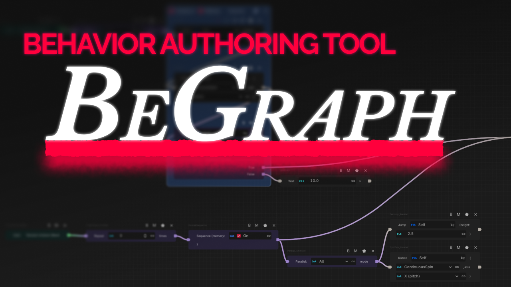
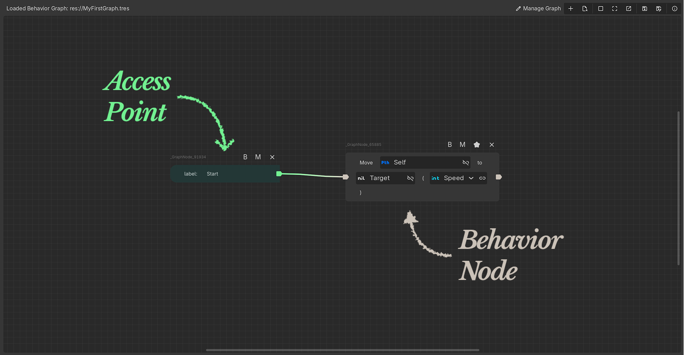

# BeGraph


[](https://godotengine.org) [](LICENSE) []()

**BeGraph** is a high-performance visual Behavior Graph engine crafted for **Godot 4**, built in collaboration with [W4 Games](https://www.w4games.com). It merges the intuitive readability of visual graph canvases with the modularity, deterministic execution, and reactive state management of production-grade game AI.

Whether you are crafting intricate stealth patrol logic in 2D, orchestrating boss fight phase machines, or simulating aerial 3D drone navigation with Jolt Physics, BeGraph gives you the tools to design, test, and debug your AI without leaving Godot.


---

## Key Highlights

- **Dedicated Visual Editor Dock**: Seamlessly integrated into Godot's bottom panel. Always accessible, non-intrusive, and supports custom categories, themes, and zooming.
- **Reactive Blackboard with Drag & Drop**: Decouple logic from scene data. Drag variables directly from the Inspector onto node variable slots with real-time type compatibility validation.
- **Lightweight `BehaviorAgent` Runtime**: Drive behaviors on Idle, Physics, or Manual process loops. Throttle execution via `tick_interval` for effortless scalability across massive crowds of NPCs.
- **Built-in Decorator Tree**: Attach Inverters, Repeaters, Cooldowns, Time Limits, Delays, or Conditions directly to your nodes without cluttering the canvas with extra decorator boxes.
- **Hierarchical Subgraphs & Embedding**: Inline external graphs using **Embed Graph** or execute modular subroutines with **Run Subgraph**, including real-time, two-way blackboard sharing.
- **Executable Sequence Frames**: Organize your canvas with visual frames, or toggle `is_sequence = true` to convert frames into procedural Sequence composites with deterministic order badges (`#1`, `#2`, `#3`).
- **Live Telemetry & In-Game Debugger (`F3`)**: Inspect execution flow in real-time. Watch nodes glow green (`SUCCESS`), yellow (`RUNNING`), or red (`FAILURE`) in the editor debugger tab, or press `F3` to open the live debug overlay directly inside your running game.
- **Ready-to-Play 2D & 3D Gyms**: Includes 10 fully configured interactive stations showcasing patrol circuits, sentry turrets, navigation tag games, vision cones, Jolt rigid body impulses, and aerial drone orbits.

---

## Quick Start (5 Minutes to Your First Agent)

### 1. Enable the Plugin
Ensure the addon is located at `res://addons/BeGraph/` and enable **BeGraph** in **Project -> Project Settings -> Plugins**.

### 2. Create a Behavior Graph
1. Open the **Behavior Graph** bottom dock.
2. Click **New** and choose a save path (e.g., `res://ai/my_first_graph.tres`).
3. BeGraph automatically seeds your new graph with an **Access Point** entry node.
4. Right-click the canvas and add an Behavior Node (e.g., `Move To Point` or `Wait`).
5. Drag a connection from the Access Point's right output slot to your action node's left input slot.
6. Click **Save** in the dock toolbar.



### 3. Attach a BehaviorAgent to Your Entity
1. Open your character or NPC scene.
2. Add a **`BehaviorAgent`** node as a child of your character.
3. In the Inspector, assign your `my_first_graph.tres` to the **`Behavior Graph`** property.
4. Select your **`Starting Point`** from the dropdown.
5. Set **`Graph Process Mode`** to `PHYSICS` (for kinematic bodies) or `IDLE`.
6. Press **Play Scene** to watch your AI execute!

---

## Documentation Suite

Comprehensive tutorials, architecture deep dives, and API references are available in the **[`docs/`](docs/)** directory:

| Document | Description |
|---|---|
| **[Documentation Hub](docs/README.md)** | Overview, learning paths, and complete index of guides. |
| **[Writing Classic BehaviorNodes](docs/custom_nodes.md)** | Step-by-step tutorial on authoring action and condition nodes extending `BehaviorNode`. |
| **[Writing Special Custom Nodes](docs/special_nodes.md)** | Creating nodes with dedicated visual scenes (`DISPLAY_SCENE`) like Access Points and Comments. |
| **[Categories & Node Scanning](docs/categories_and_scanning.md)** | Auto-scanning external folders (`Additional Nodes`) and styling custom categories via Project Settings. |
| **[The Blackboard System](docs/blackboard.md)** | In-depth guide to `BlackboardVariable`, drag-and-drop inline binding, and type compatibility. |
| **[BehaviorAgent & NodePaths](docs/behavior_agent.md)** | Process threads, tick throttling, and mastering strict absolute `NodePath` resolution vs script injection. |
| **[Canvas Editing & Workflow](docs/editing_and_workflow.md)** | Copy/Paste/Cut/Duplicate shortcuts, Sequence Frames, Decorator Tree, and Breakpoint/Mute tools. |
| **[Embedding Graphs](docs/embed_graphs.md)** | Merging external graphs directly into frames with automated blackboard unbinding. |
| **[The Run Subgraph Node](docs/run_subgraph.md)** | Modular hierarchical graphs, runtime caching, recursion guards, and shared blackboard variables. |
| **[Gym 2D Showcase](docs/gym_2d.md)** | Complete walkthrough of the 5 interactive 2D stations (Patrol, Sentry, Tag, FOV, Ambient). |
| **[Gym 3D Showcase](docs/gym_3d.md)** | Complete walkthrough of the 5 interactive 3D stations (Elevation, 3D Sentry, Jolt Physics, Drone Orbit, Acrobatics). |
| **[Advanced Features & Debugging](docs/advanced_features.md)** | Telemetry stack: Editor Debugger Tab, In-Game Overlay (`F3`), and Sequence Frame mechanics. |

---

## Interactive Demos: 2D & 3D Gyms

BeGraph comes pre-packaged with two interactive showcase arenas demonstrating real-world game AI setups:

### Gym 2D
- **Station 1 (Patrol)**: 4 agents demonstrating Once, Loop, Ping-Pong, and Ping-Pong Loop path iteration.
- **Station 2 (Sentry)**: Proximity detection, RayCast2D line-of-sight checks, warning sound effects, and projectile firing.
- **Station 3 (Tag Arena)**: Dynamic Chaser vs. Runner state machine powered by Godot 2D Navigation polygons.
- **Station 4 (Field of View)**: Stealth vision cone with sweeping rotation and suspicious/detected alert states.
- **Station 5 (Ambient)**: Procedural idle behaviors combining random selectors, tweening squashes, and pauses.

### Gym 3D
- **Station 1 (Elevation Patrol)**: 3D ramp climbing with summit particle system triggers.
- **Station 2 (3D Sentry)**: 3D spherical perception, dynamic spotlight modulation, spatial audio, and 3D projectile spawning.
- **Station 3 (Physics Impulse)**: Applying directional impulse forces to Jolt `RigidBody3D` crates inside a trigger pit.
- **Station 4 (Drone Orbit)**: Aerial hovering drone executing circular orbits around an obstacle pylon.
- **Station 5 (Acrobat Jump)**: Complex `Parallel` concurrency executing flips, vertical jump physics, and mesh tween distortions.

---

## Project Structure

```text
res://
├── addons/
│   └── BeGraph/
│       ├── Classes/          # Core BeGraph classes (BehaviorNode, BehaviorGraph, BehaviorAgent, etc.)
│       │   ├── GraphStuff/   # Visual graph edit canvas, frame, comment, and access point classes
│       │   ├── Nodes/        # Built-in behavior nodes (Actions, Conditions, Composites, Decorators)
│       │   └── misc/         # Blackboard, drop layers, utility constants, and info panel
│       ├── Debug/            # Live debugger plugin, debug bridge autoload, and F3 runtime overlay
│       ├── DEMO/             # 2D & 3D interactive Gym showcase scenes and stations
│       ├── Icons/            # High-resolution SVG icons for editor menus and titlebars
│       ├── UI/               # Pre-built Godot .tscn scenes for the dock and node widgets
│       └── BeGraph.gd        # Main EditorPlugin entry point
├── Additional Nodes/         # External sample library scanned automatically via Project Settings
└── docs/                     # Full documentation suite and screenshot media guides
    ├── media/                # Target folder for documentation screenshots
    └── *.md                  # Topic guides and walkthroughs
```

---

## Contributing

Contributions, feature requests, and bug reports are welcome!
Feel free to open an issue or submit a pull request on GitHub.

---

## License

BeGraph is open-source software licensed under the [MIT License](LICENSE).
