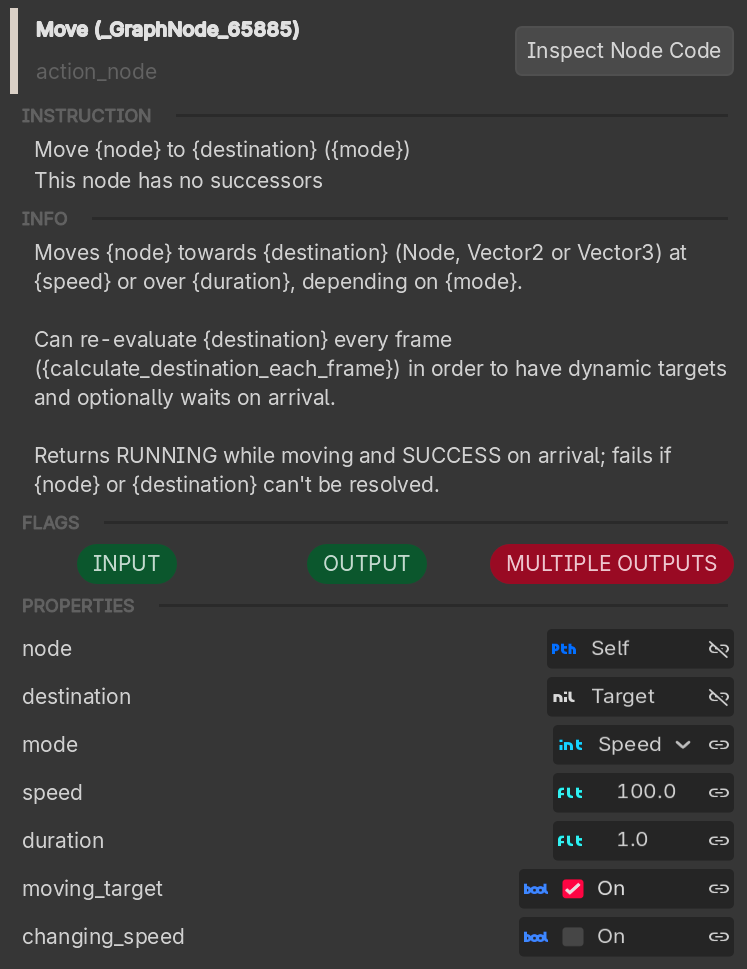

# Advanced Features

## Sequence Frames: Procedural Execution

While standard frames provide visual organization, enabling **`is_sequence = true`** converts the frame into an executable Sequence composite:

```
┌────────────────────────────────────────────────────────┐
│ Patrol Sequence Frame                       [Seq Mode] │
│                                                        │
│   ┌──────────────┐     ┌──────────────┐                │
│   │ #1 MoveTo A  │────►│ #2 PlayAnim  │                │
│   └──────────────┘     └──────┬───────┘                │
│                               │                        │
│                               ▼                        │
│                        ┌──────────────┐                │
│                        │ #3 Wait 2.0s │                │
│                        └──────────────┘                │
└────────────────────────────────────────────────────────┘
```

### Execution Ordering
BeGraph computes the deterministic execution order of attached nodes:
1. It follows internal connections starting from the entry node(s) with an in-degree of 0.
2. For unlinked nodes, it falls back to spatial ordering: top-to-bottom, then left-to-right.
3. Each node displays an accent-colored badge (`#1`, `#2`, `#3`) indicating its priority.

### Memory Mode
When **`memory`** is enabled:
- If a child node returns `RUNNING` (such as a 5-second `Wait` or a long travel action), the frame preserves its index.
- On the next tick, execution resumes directly at that running node rather than re-evaluating preceding completed nodes.

---

## Node Breakpoints & Mute

Individual nodes feature titlebar toggles for rapid isolation testing:

- **Breakpoint (`[B]`)**: Inserts an instantaneous GDScript `breakpoint` when the node is ticked. The engine pauses execution in your code editor, allowing you to inspect call stacks, local variables, and agent state in Godot's script debugger.
- **Mute (`[M]`)**: Skips the node entirely and propagates control flow immediately to its successors. This allows you to test AI fallback behaviors without deleting or rewiring nodes.

---

## The Node Info Panel

Clicking the **Info** button (`info_button`, `info_icon.svg`) in the BeGraph dock opens the **Node Info Panel** (`BehaviorNodeInfoPanel.tscn`).

Selecting any node on the canvas populates this panel with:
- The node's class name, script path, and category.
- The full `DISPLAY_INFO` documentation string.
- A list of all exposed behavior properties and their current blackboard bindings.
- Active decorator configuration summary.



---

## Next Steps
- Return to the [Documentation Hub](README.md) for a complete list of guides and tutorials.
