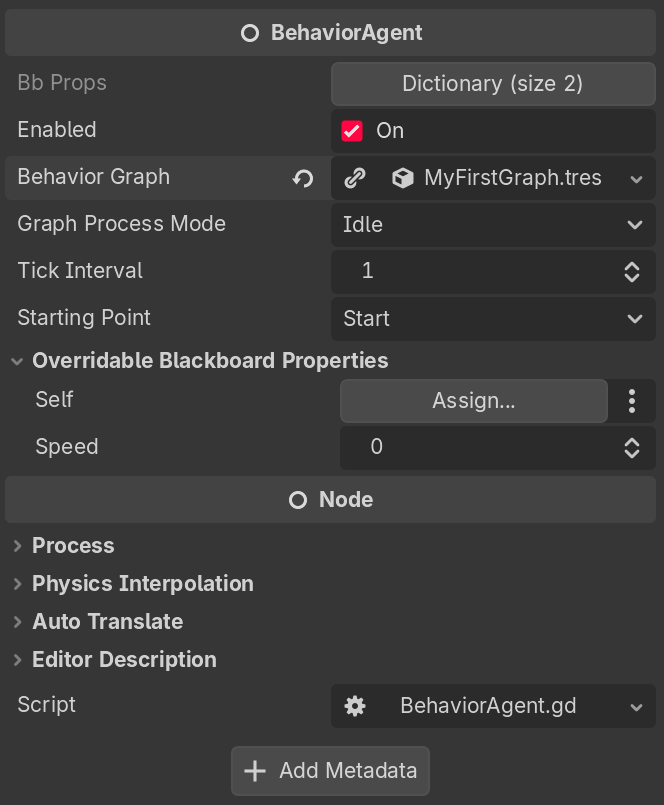

# BehaviorAgent & NodePath Resolution

The **`BehaviorAgent`** is the runtime engine of BeGraph. While `BehaviorGraph` is a passive `Resource` defining AI logic and blackboard structure, `BehaviorAgent` is a Godot `Node` attached to your scene entities (characters, turrets, drones, bosses) that executes the graph, handles process threads, and exposes blackboard variables to the Inspector.

---

## Attaching and Configuring a BehaviorAgent

To equip an entity with BeGraph AI:
1. Add a `BehaviorAgent` node as a child of your character/entity scene.
2. In the Inspector, assign your `.tres` file to the **`Behavior Graph`** property.
3. Choose the **`Starting Point`** from the dynamic dropdown.
4. Configure process mode, tick interval, and overridable blackboard properties.



---

## Core Properties & Process Modes

### 1. `graph_process_mode` (Enum: `ProcessThread`)
Controls when and where the graph is evaluated:
- **`IDLE`** (`0`): Ticks in `_process(delta)`. Best for visual logic, UI agents, cameras, or standard NPCs.
- **`PHYSICS`** (`1`): Ticks in `_physics_process(delta)`. Recommended for kinematic bodies, rigid bodies, raycasts, and collision checks.
- **`MANUAL`** (`2`): Disables automatic engine ticking. You must call `behavior_agent.tick(delta)` manually from your own code (e.g., in a turn-based system or custom AI manager).

### 2. `tick_interval` (Integer)
Lets the user choose which tick goes actually in execution (i.e. `1` (default): Ticks every single frame, `2`: Ticks every 2nd frame, `4`: Ticks every 4th frame, reducing AI overhead by 75%, etc...)

### 3. `starting_point` (Dynamic Enum)
A single Behavior Graph can host multiple distinct routines, each initiated by an `AccessPointNode`. `BehaviorAgent` scans the graph's access points and compiles their labels into an enum. This allows different actors to share the exact same `.tres` graph file while running completely different behaviors (e.g., Actor A runs "Patrol: Loop", while Actor B runs "Patrol: Ping-Pong").

---

## Runtime Instantiation & Graph Duplication

When the scene starts (`_ready()`), `BehaviorAgent` automatically performs a deep clone of the graph resource:

```gdscript
_behavior_graph = behavior_graph.duplicate_deep(Resource.DEEP_DUPLICATE_ALL)
_behavior_graph.setup_runtime(self, behavior_graph)
```

This guarantees that:
- Every agent runs an independent runtime state (node statuses, timers, running branches).
- Modifying a blackboard variable on one agent does not inadvertently overwrite values on another agent running the same graph resource.

---

## Exposing Blackboard Variables to the Inspector

Any `BlackboardVariable` in the graph with **`export_variable = true`** is automatically mirrored in the `BehaviorAgent` Inspector under:
```text
overridable_blackboard_properties/<variable_name>
```

This allows level designers to adjust variables (such as patrol speed, health limits, or detection ranges) for specific instances placed in a level without modifying the graph resource.

---

## Shared Blackboard Variables between Graphs

If the user wants multiple instances of the same graph to reference the same `BlackboardVariable` having, de facto, shared variables, being `BlackboardVariable` resources, they can be created inside of one of the project's directories and then referenced as external resource inside of a blackboard. Even if graphs get duplicated deeply, the reference to the shared variable gets rebuilt

---

## The NodePath Conundrum: Inspector Relative vs. Absolute Runtime Paths

### 1. Why `BehaviorNode` Requires Absolute NodePaths
Individual `BehaviorNode`s are Godot `Resource`s, not `Node`s. They do not occupy a fixed slot in the `SceneTree`. When a node executes `eval("target", true)` to fetch a property value, and if the `"target"` property is a `Nodepath` ,`BehaviorNode._resolve_node()` evaluates the path:

```gdscript
# BehaviorNode.gd
func _resolve_node(value: Variant) -> Node:
	if value is NodePath and value != NodePath(""):
		# ... checks resolved nodes cache ...
		if value.is_absolute():
			var tree := Engine.get_main_loop() as SceneTree
			resolved = tree.root.get_node_or_null(value)
		else:
			push_error("BehaviorNode %s: node path is not absolute '%s'" % [resource_name, value])
```

> [!IMPORTANT]
> `_resolve_node()` **strictly demands absolute NodePaths** (paths starting with `/root/...`). Any relative NodePath passed directly to `_resolve_node()` fails and logs an error!

---

### Case A: Nodes within the Same Hierarchy (Inspector Assignable)
If the target node is inside the entity's own scene tree (for example, the actor's own `CollisionShape2D`, `AnimationPlayer`, `Sprite2D`, or a direct child), the exposed blackboard property on `BehaviorAgent` can be assigned via the Inspector using Godot's node picker or the drag-and-drop system. At runtime in `BehaviorAgent._ready()`, BeGraph automatically converts any relative `NodePath` inside the agent's hierarchy into a global absolute path:

```gdscript
# BehaviorAgent.gd
for p in bb_props:
	var v = get(p)
	if v == null: continue

	if v is NodePath and !v.is_absolute() and !v == ^"":
		v = get_node(v).get_path() # Converts relative path to absolute /root/... path!
	set_blackboard_property(p, v)
```

As long as the target node is part of the agent's scene hierarchy, Inspector assignment works seamlessly out of the box!

---

### Case B: External Nodes (Dependency Injection Pattern)
If the node you need to reference is outside the entity's scene tree (e.g., the `Player`, a shared `GameManager`, an arena `TriggerArea`, or a dynamically spawned waypoint). In this case you cannot reliably pick it from the Inspector in a reusable scene file and even if set in a level scene, cross-scene relative paths are fragile and prone to breaking.

The solution is to inject the absolute `NodePath` programmatically from a script during `_ready()` using `set_blackboard_property()`:

```gdscript
# StationController.gd or MainLevel.gd
extends Node2D

@onready var sentry_agent: BehaviorAgent = $Sentry/BehaviorAgent
@onready var player: CharacterBody2D = $Player
@onready var arena_trigger: Area2D = %ArenaTrigger

func _ready() -> void:
	# node.get_path() returns an absolute NodePath (e.g. "/root/Level/Player")
	sentry_agent.set_blackboard_property(&"Player", player.get_path())
	sentry_agent.set_blackboard_property(&"ArenaZone", arena_trigger.get_path())
```

---

## BehaviorAgent Runtime API Reference

```gdscript
# Updates or injects a blackboard value at runtime
behavior_agent.set_blackboard_property(key: StringName, value: Variant) -> bool

# Reads a blackboard property value from the live runtime graph
behavior_agent.get_blackboard_property_value(key: StringName, default_value: Variant = null) -> Variant

# Manually ticks the graph (when graph_process_mode is MANUAL)
# If delta is omitted (-1.0), elapsed time since last tick is automatically measured
behavior_agent.tick(delta: float = -1.0) -> void

# Returns the agent's active duplicated BehaviorGraph instance (for inspection/debugging)
var runtime_graph: BehaviorGraph = behavior_agent.get_debug_graph()
```

---

## Next Steps
- See how these injection patterns are used in practice across the [2D Gym Walkthrough](gym_2d.md) and [3D Gym Walkthrough](gym_3d.md).
- Learn how to run nested modular graphs with [Run Subgraph](run_subgraph.md).
