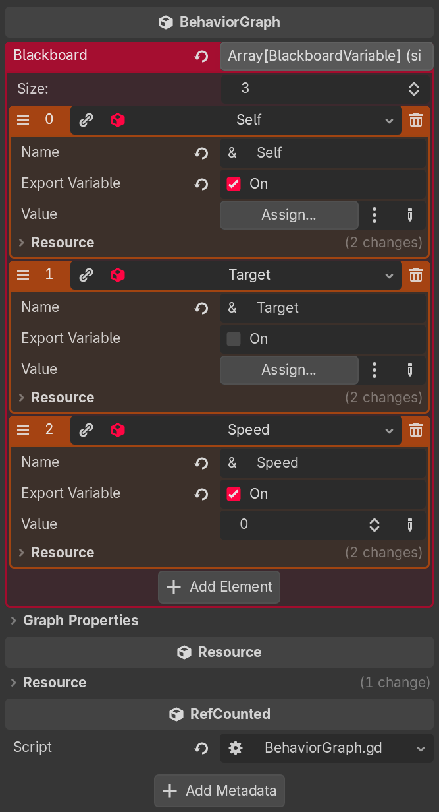
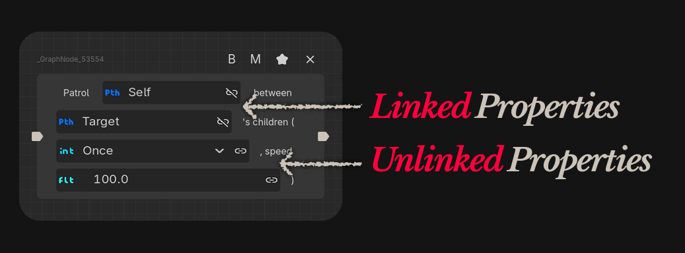
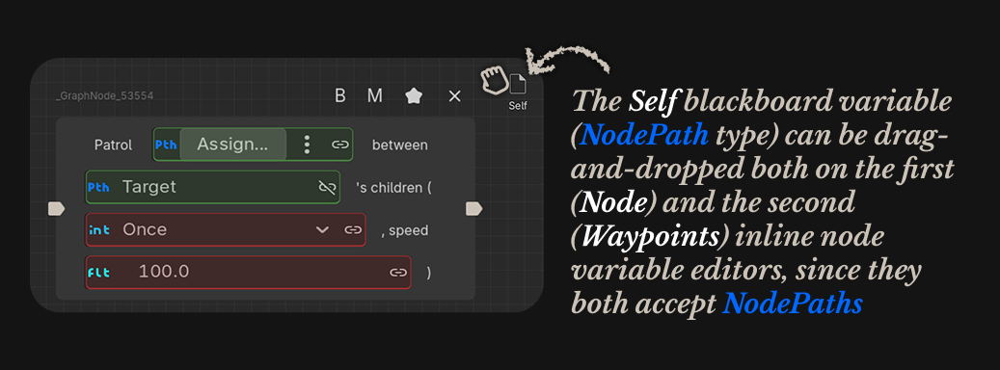

# The Blackboard System

The **Blackboard** is BeGraph's data-sharing backbone. It decouples behavior logic from specific scene objects and numerical values. Rather than hardcoding vectors, speeds, or node references directly into individual action nodes, nodes bind their properties to blackboard variables. This enables:
- Multiple nodes to read and mutate shared state (e.g., target location, alert level, ammo count).
- Subgraphs to inherit and share data with parent graphs.
- Scene designers to override variables per agent directly in the Godot inspector.

It can be accessed via the "Manage Graph" button in the Behavior Graph toolbar that makes the Inspector edit the loaded graph. 

---

## The `BlackboardVariable` Resource

A blackboard entry is an instance of `BlackboardVariable` (`addons/BeGraph/Classes/misc/BlackboardVariable.gd`), which extends Godot's `Resource`.

Each variable has three key properties:
- **`name: StringName`**: The identifier used to reference this variable (e.g., `TargetPosition`, `PlayerRef`, `IsAlerted`).
- **`export_variable: bool`**: When checked, this variable is exposed on any `BehaviorAgent` executing this graph, allowing per-instance overrides in scene files (see [BehaviorAgent & NodePaths](behavior_agent.md)).
- **`value: Variant`**: The stored data. It can hold any Godot Variant type (`int`, `float`, `bool`, `String`, `Vector2`, `Vector3`, `NodePath`, `Color`, etc.). In the Godot Inspector, the type is set to `Variant (Nil)`, allowing you to use Godot's built-in "Convert to..." selector to assign any type.


> 
---

## Inline Variable Editors & Drag-and-Drop Binding

Every property declared inside curly brackets in a node's `set_instruction()` (e.g., `set_instruction() -> "Move toward {target} at {speed}"`) generates an inline editor row (`BehaviorGraphNodeVariableEditor`) inside of the visual representation of that node in the graph.

Each editor row features two operational modes:

```
[Unlinked Mode]
┌──────────────────────────────────────────────────────────┐
│ [Type Icon]  [EditorProperty Widget (e.g., SpinBox)] [🔗]│
└──────────────────────────────────────────────────────────┘

[Linked Mode]
┌───────────────────────────────────────────────────────────┐
│ [Type Icon]  [BB: "TargetPosition" (Read-Only Label)] [❌]│
└───────────────────────────────────────────────────────────┘
```



---

### Binding a Blackboard Property
The user can either Click the link icon (`🔗`) next to the unlinked property editor and select one of the variables inside the popup (the popup displays only variables whose types are compatible with that property), or drag-and-drop a variable from the Blackbaord itself (the color from the inline editor changes based on wether the property is compatible or not with that variable type, green if compatible, red if not).



Type compatibilities are as close as one can get to the ones offered by godot (i.e. an `int` blackboard variable can be used for a `float` property).

To unlink a property you can just click the `[❌]` unlink button. The editor will restore its local value editor, and BeGraph pushes an undo/redo action so you can revert if needed

Linked properties update automatically if the blackboard variable's name changes or if it changes its type.

---

## Runtime Blackboard Access

### Automatic Interception via `_get()` and `_set()`
When a property is linked to a blackboard variable, `BehaviorNode` overrides GDScript's `_get()` and `_set()` methods. Reading or writing the property in script interacts directly with the blackboard:

```gdscript
# Inside a custom BehaviorNode:
var current_speed = speed # Automatically reads from the linked blackboard variable!

# Writing to the property updates the blackboard:
speed = 300.0 # Updates the blackboard variable value in real-time!
```

### Safe Resolution with `eval()`
To safely retrieve values with a fallback if unbound, use `eval()`:

```gdscript
var current_speed: float = eval(&"speed", false, 150.0)
```

### Direct Graph API
You can also inspect and manipulate the blackboard directly on `BehaviorGraph`:

```gdscript
# Read a value
var pos: Vector2 = graph.get_blackboard_value(&"TargetPosition", Vector2.ZERO)

# Write a value (emits graph.blackboard_value_changed)
graph.set_blackboard_value(&"TargetPosition", Vector2(400, 250))

# Retrieve the raw BlackboardVariable resource
var bb_var: BlackboardVariable = graph.get_blackboard_property(&"TargetPosition")
```

---

## Next Steps
- Learn how to expose and override these variables per scene in [BehaviorAgent & NodePaths](behavior_agent.md).
- Learn how to share blackboards across nested graphs in [Run Subgraph](run_subgraph.md).
