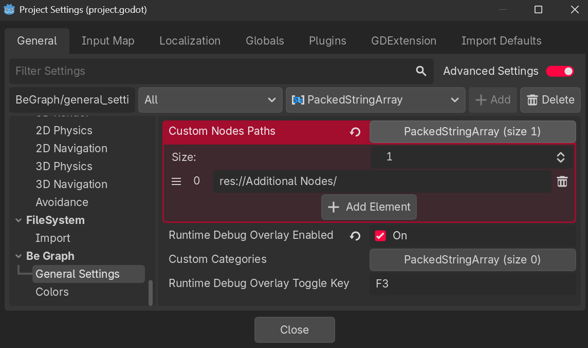
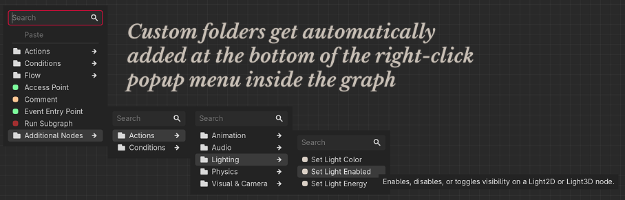
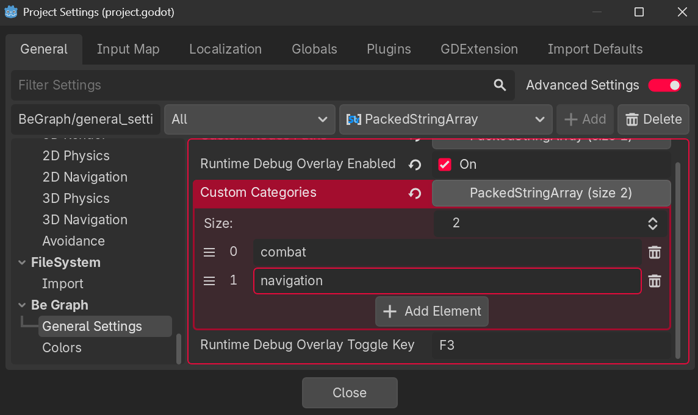
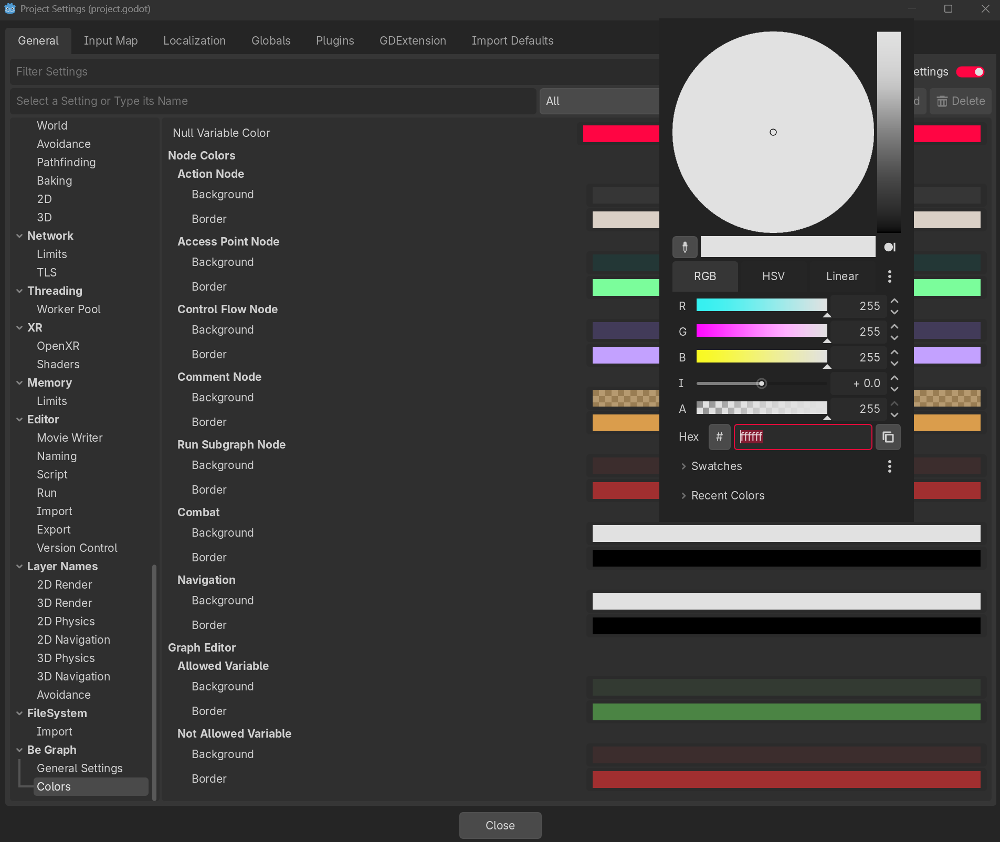

# Categories and Node Scanning

BeGraph features an automated discovery engine and a flexible category styling system. By configuring **Project Settings**, you can:
1. Scan external project directories for custom nodes without modifying the core addon files.
2. Define custom categories with bespoke background and selection border colors.

> [!IMPORTANT]
> For any edit to the Project Settings to take actually place you must restart the engine.
---

## Adding Custom Scan Folders (`custom_nodes_paths`)

By default, BeGraph scans `res://addons/BeGraph/Classes/Nodes/` to populate the right-click node creation menu. To include project-specific or team-shared nodes located elsewhere in your project (such as `res://Additional Nodes/`), you register them in **Project Settings**.

### Step-by-Step Configuration

1. Open **Project -> Project Settings...** in Godot.
2. Ensure **Advanced Settings** is toggled ON if you want to inspect low-level property hints (though BeGraph properties are also marked as *basic* settings).
3. In the left tree, locate **BeGraph -> General Settings**.
4. Find the property **`custom_nodes_paths`** (Type: `PackedStringArray`).
5. Click **Add Element** and specify the path to your folder:
   ```text
   res://Additional Nodes/
   ```




BeGraph recursively mirrors your folder hierarchy into nested submenus in the creation popup menu.



---

## Defining Custom Categories (`custom_categories`)

Each node category has a designated visual identity (background color, titlebar style, and selection/port border color). 

Built-in categories include:
- `action_node`: Neutral dark background, off-white/beige border.
- `access_point_node`: Deep teal background, bright mint/cyan border.
- `control_flow_node`: Deep plum/purple background, lilac border.
- `comment_node`: Warm brownish amber background and border.
- `run_subgraph_node`: Deep maroon/crimson background and border.

### Creating New Categories

You can define your own domain-specific categories (e.g. `combat`, `dialogue`, `navigation`):

1. In **Project -> Project Settings**, navigate to **BeGraph -> General Settings**.
2. Locate **`custom_categories`** (`PackedStringArray`).
3. Add your category identifiers:
   - `combat`
   - `navigation`
4. Save and close Project Settings (or reload the project).



### Assigning Colors to Custom Categories
When BeGraph detects new categories in `custom_categories`, its internal `_sync_settings()` generates color settings under `BeGraph/colors/node_colors/<category>`:
- `BeGraph/colors/node_colors/combat/background`
- `BeGraph/colors/node_colors/combat/border`
- `BeGraph/colors/node_colors/navigation/background`
- `BeGraph/colors/node_colors/navigation/border`

You can then use Godot's color pickers in Project Settings to assign distinct hues (for example, fiery red for `combat`, emerald green for `navigation`).



### Using the Custom Category in Your Node Script
In your custom node, simply override `set_node_category()` to return your category name:

```gdscript
@tool
class_name AttackNode
extends BehaviorNode

const DISPLAY_NAME: String = "Perform Melee Attack"
const DISPLAY_ICON: String = "res://addons/BeGraph/Icons/action_node_icon.svg"

func set_node_category() -> String:
	return "combat"

func set_instruction() -> String:
	return "Execute melee strike against {target}"

# ... remainder of node logic
```

When you drop this node onto the canvas, BeGraph immediately queries `BeGraph/colors/node_colors/combat` and applies your colors to the node's background, titlebar, border, and port connections!

---

## Next Steps
- Learn how to declare variable inputs on your nodes in [Writing Classic Custom BehaviorNodes](custom_nodes.md).
- Connect node variables to dynamic blackboard values in [The Blackboard System](blackboard.md).
