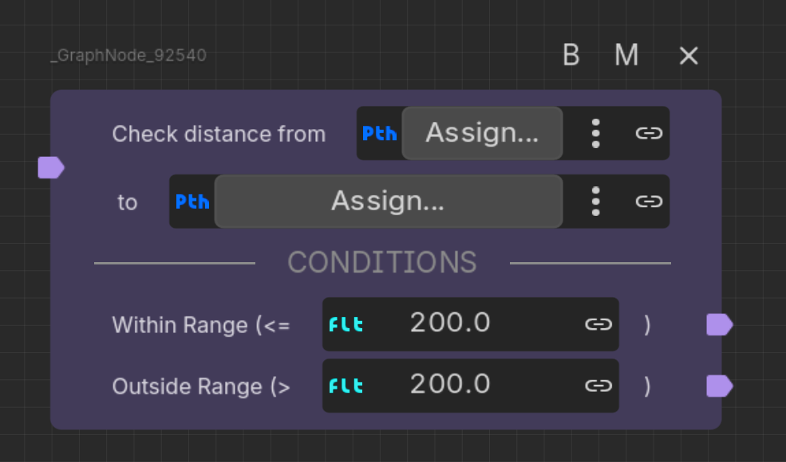

# Writing Classic Custom BehaviorNodes

In **BeGraph**, custom AI behaviors and state logic are created by extending the `BehaviorNode` class. Whether you need an action to move an entity, play an animation, cast a ray, or check health status, understanding the node lifecycle and metadata system allows you to build clean, modular, and reusable nodes that seamlessly integrate into the BeGraph editor.

---

## Architecture & Class Anatomy

Every node script must:
1. Include the `@tool` annotation so Godot's editor can inspect, render, and validate it within the BeGraph dock.
2. Extend `BehaviorNode`.
3. Can optionally (recommended) provide metadata constants for the editor UI (`DISPLAY_NAME`, `DISPLAY_ICON`, `DISPLAY_INFO`) .
4. Implement configuration methods (`set_instruction()`, `set_node_category()`, `set_input()`, `set_output()`, `set_allows_multiple_outputs()`).
5. Implement execution logic in `tick(delta: float) -> Status` (and optional lifecycle hooks `on_start()` and `on_end()`).

---

## Script Metadata & Constants

BeGraph uses script-level constants to customize how the node appears in the node creation menu and graph canvas:

```gdscript
@tool
class_name MoveToTargetNode
extends BehaviorNode

## Human-readable name displayed in menus and node headers.
const DISPLAY_NAME: String = "Move To Target"

## Path to an SVG icon representing this node in the catalog.
const DISPLAY_ICON: String = "res://addons/BeGraph/Icons/action_node_icon.svg"

## Detailed documentation shown in the info panel and tooltips.
const DISPLAY_INFO: String = "Moves a CharacterBody2D towards a target position using linear interpolation or velocity."
```

---

## Category, Slots, and Instruction Formatting

### 1. Assigning a Category
Categories determine node color coding and classification. By default, BeGraph includes built-in categories such as `"action_node"`, `"control_flow_node"`, `"access_point_node"`, and `"comment_node"`. You can also return custom category strings (see [Categories and Node Scanning](categories_and_scanning.md)):

```gdscript
func set_node_category() -> String:
	return "action_node"
```

### 2. Configuring Input and Output Slots
- **`set_input() -> bool`**: Returns `true` if this node can have predecessors. Return `false` for entry points.
- **`set_output() -> bool`**: Returns `true` if this node has an unconditional output port. Note: If your node defines branching conditions via `set_conditions()`, BeGraph automatically forces `set_output()` to `false`.
- **`set_allows_multiple_outputs() -> bool`**: Returns `true` if multiple connections can leave the output port (used by composites like Sequences and Selectors). For standard sequential actions, return `false`.

```gdscript
func set_input() -> bool:
	return true

func set_output() -> bool:
	return true

func set_allows_multiple_outputs() -> bool:
	return false
```

### 3. Inline Instructions & Variable 
holders
The text displayed inside the node body is defined by `set_instruction()`. You can insert property names surrounded by curly brackets (`{property_name}`). BeGraph replaces these brackets with inline property editors (see [Blackboard & Inline Editors](blackboard.md)):

```gdscript
func set_instruction() -> String:
	return "Move {actor} toward {target} at speed {speed} px/s (tolerance: {tolerance})"
```

---

## Defining Properties: The `BG.PROPERTY` Annotation

To expose variables to the node's inline editor and blackboard binding system, use Godot's `@export_custom` annotation prefixed with `BG.PROPERTY`:

```gdscript
## Target character body to move
@export_custom(PROPERTY_HINT_NODE_TYPE, BG.PROPERTY + "CharacterBody2D") 
var actor: NodePath = NodePath("")

## Target position or target node
@export_custom(BG.HINT_NONE, BG.PROPERTY) 
var target: Vector2 = Vector2.ZERO

## Movement speed
@export_custom(BG.HINT_NONE, BG.PROPERTY) 
var speed: float = 150.0

## Distance tolerance to consider destination reached
@export_custom(BG.HINT_NONE, BG.PROPERTY) 
var tolerance: float = 10.0
```

> [!NOTE]
> `BG.PROPERTY` is defined as `"BeGraph:property:"` in `BGUtils.gd`. It signals to BeGraph that this property should be registered as an overridable, bindable graph variable.

---

## Node Lifecycle & Execution Flow

When a node executes, BeGraph orchestrates its lifecycle methods:

```
              [Predecessor ticks]
                      │
                      ▼
               ┌──────────────┐
               │  on_start()  │  (Called when transitioning from non-RUNNING)
               └──────┬───────┘
                      │
                      ▼
               ┌──────────────┐
               │ tick(delta)  │ ◄─────── (Called every frame while RUNNING)
               └──────┬───────┘
                      │
        ┌─────────────┴─────────────┐
        ▼                           ▼
[Returns RUNNING]          [Returns SUCCESS / FAILURE]
        │                           │
        │                           ▼
   (Wait next frame)         ┌──────────────┐
                             │   on_end()   │
                             └──────┬───────┘
                                    │
                                    ▼
                          [Automatic Propagation /
                             tick_next(delta)]
```

### 1. `on_start() -> void`
Called once when the node transitions from an idle/not running state into active execution. Use this method to initialize timers, reset counters, or capture starting positions.

### 2. `tick(delta: float) -> Status`
Contains the core execution logic. Must return one of:
- `Status.SUCCESS`: The action completed successfully.
- `Status.FAILURE`: The action failed to achieve its goal.
- `Status.RUNNING`: The action is still progressing and requires future ticks.
- `Status.ERROR`: An unrecoverable error occurred (e.g., missing node or invalid data).

### 3. `on_end(status: Status) -> void`
Called when the node completes execution with either `Status.SUCCESS` or `Status.FAILURE`. Clean up temporary tweens, reset animations, or zero out velocities here.

### 4. `abort(error_msg: String = "") -> Status` & `_on_abort_running(visited: Dictionary)`
Called when a parent node (such as a Parallel node or reactive Selector) interrupts this node while it is `RUNNING`. Override `_on_abort_running()` if your node requires custom cleanup when aborted mid-execution.

---

## Reading Values and Resolving Nodes: `eval()` & `_resolve_node()`

Because properties may be bound to variables in the [Blackboard](blackboard.md), **never read raw variables directly** if they might be dynamic. Instead, use `eval()`:

```gdscript
# Resolves target vector (from blackboard if bound, otherwise uses local exported value)
var target_pos: Vector2 = eval(&"target")

# Resolves a NodePath and fetches the actual Node instance in one call
var body: CharacterBody2D = eval(&"actor", true) as CharacterBody2D
```

> [!IMPORTANT]
> `_resolve_node()` strictly expects **absolute `NodePath`s** (e.g., `/root/MainScene/Player`) or direct node references. If passed a relative `NodePath` (e.g., `../Player`), it logs an error because `BehaviorNode` is a `Resource` without its own SceneTree coordinates. For details on how relative paths are converted or how external nodes must be injected, see [BehaviorAgent & NodePaths](behavior_agent.md).

---

## Creating Condition Nodes with Multiple Branching Outputs

If you want a node to branch into multiple execution paths (like an IF statement, Enum selector, or distance threshold), implement `set_conditions()`:

```gdscript
@tool
class_name DistanceBranchNode
extends BehaviorNode

const DISPLAY_NAME: String = "Distance Branch"
const DISPLAY_ICON: String = "res://addons/BeGraph/Icons/control_flow_node_icon.svg"
const DISPLAY_INFO: String = "Compares distance to target against a threshold and branches."

@export_custom(PROPERTY_HINT_NODE_TYPE, BG.PROPERTY + "Node2D") var actor: NodePath = NodePath("")
@export_custom(PROPERTY_HINT_NODE_TYPE, BG.PROPERTY + "Node2D") var target: NodePath = NodePath("")
@export_custom(BG.HINT_NONE, BG.PROPERTY) var range_threshold: float = 200.0

func set_node_category() -> String:
	return "control_flow_node"

func set_input() -> bool:
	return true

## Multiple conditions force set_output() to false; each condition becomes its own output port.
func set_conditions() -> PackedStringArray:
	return PackedStringArray([
		"Within Range (<= {range_threshold})",
		"Outside Range (> {range_threshold})"
	])

func set_instruction() -> String:
	return "Check distance from {actor} to {target}"

func tick(delta: float) -> Status:
	var a_node := eval(&"actor", true) as Node2D
	var t_node := eval(&"target", true) as Node2D
	
	if a_node == null or t_node == null:
		return abort("Invalid actor or target node reference")
	
	var dist := a_node.global_position.distance_to(t_node.global_position)
	var threshold: float = eval(&"range_threshold")
	
	if dist <= threshold:
		# Tick the first condition slot (index 0: Within Range)
		return tick_condition(delta, 0)
	else:
		# Tick the second condition slot (index 1: Outside Range)
		return tick_condition(delta, 1)

func set_allows_multiple_outputs() -> bool: return false
```



---

## Next Steps
- Learn how to create specialized visual nodes in [Writing Special Custom Nodes](special_nodes.md).
- Learn how to organize your custom nodes into submenus in [Categories and Node Scanning](categories_and_scanning.md).
- Understand how to bind your node's properties dynamically in [The Blackboard System](blackboard.md).
