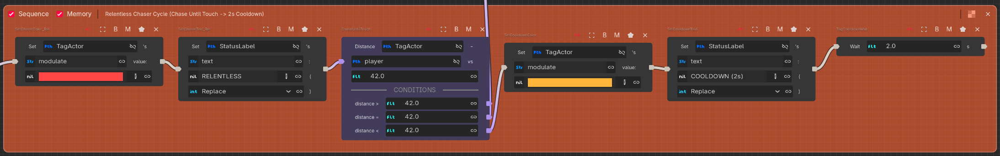
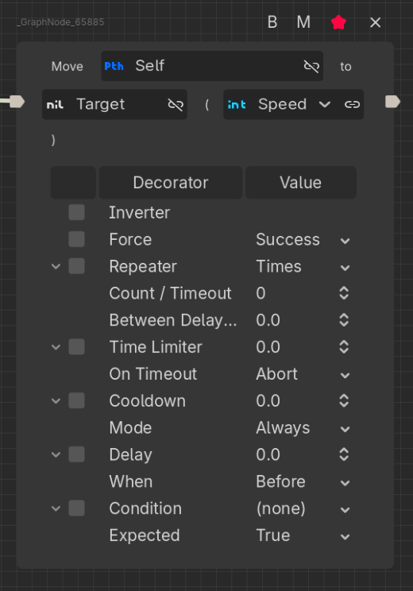

# Canvas Editing & Workflow Features

BeGraph provides a streamlined graph editing experience within the Godot editor. Beyond creating and connecting nodes, it includes native clipboard operations (Copy, Cut, Paste, Duplicate), automatic blackboard reconciliation, visual & procedural Frames, built-in node Decorators, and canvas debugging tools.

---

## Clipboard Operations: Copy, Cut, Paste, and Duplicate

BeGraph manages clipboard operations at the resource level rather than relying on raw Godot UI duplicates. This ensures references are properly cloned, connections are preserved, and undo/redo history remains consistent.

### Keyboard Shortcuts

| Action | Shortcut | Method | Behavior |
|---|---|---|---|
| **Copy** | `Ctrl + C` | `copy_selected_nodes()` | Stores deep-cloned `BehaviorNode` resources and internal connections in the clipboard. |
| **Cut** | `Ctrl + X` | `_on_cut_nodes_request()` | Copies the selection and removes the original nodes as an undoable action. |
| **Paste** | `Ctrl + V` | `_on_paste_nodes_request()` | Pastes clipboard contents at the mouse cursor position (or offset from originals). |
| **Duplicate**| `Ctrl + D` | `duplicate_selected_nodes()` | Clones and places duplicates offset by `(40, 40)` px without overwriting the clipboard. |
| **Focus** | `F` | `focus_selection()` | Centers and zooms the canvas viewport on the current selection (or all nodes if none selected). |
| **Delete** | `Delete` | `_on_delete_nodes_request()` | Deletes selected nodes and their associated connections. |

---

### Internal vs. Cross-Graph Blackboard Rebinding
When you paste or duplicate nodes, BeGraph handles blackboard bindings intelligently:
- **Pasting within the Same Graph**: BeGraph inspects the graph's blackboard. If the copied node was bound to an existing variable (e.g., `Speed`), the binding is **preserved**.
- **Pasting into Another Graph (or Embedding)**: If the target graph does not contain a blackboard variable with that exact name, `_unbind_blackboard_properties()` automatically unbinds the property and reverts it to the node's local default value. This prevents orphan references and cross-graph corruption.

---

## Frames & Sequence Frames (`BehaviorFrame`)

Frames group nodes visually for organizational clarity or turn a group of nodes into an executable sequence.



To create a frame select multiple nodes on the canvas and either click the **Add Frame** button (`FrameButton`) in the BeGraph dock toolbar or click "Frame" in the popup menu that shows up by right-clicking when one or more nodes are selected.

To detatch nodes from frame one can click the **Free from Frame** icon on an individual node's titlebar to remove it from the frame or select the nodes and click the toolbar **Free Frame** button (`FreeFrameButton`).

### 2. Standard Frame vs. Sequence Frame
Select the Frame's titlebar to inspect its properties:
- **Visual Grouping (`is_sequence = false`)**: The frame is purely organizational and has no effect on execution order.
- **Sequence Mode (`is_sequence = true`)**: The frame acts as a **Sequence composite node**!
  - Attached nodes display numerical badges (`#1`, `#2`, `#3`...) indicating execution order.
  - Execution order is computed deterministically: BeGraph follows internal connections starting from the entry node, falling back to top-to-bottom and left-to-right spatial layout.
  - **Memory (`memory = true/false`)**: In memory mode, if node `#2` returns `RUNNING`, subsequent ticks resume directly from `#2` rather than restarting from `#1`.

---

## The Built-in Decorator Tree

In classic Behavior Trees, applying a decorator (such as a Repeater, Inverter, Cooldown, or Time Limit) requires placing an extra node on the canvas and wiring it into your action. 

BeGraph eliminates canvas clutter by integrating decorators directly into every action node through an expandable **Decorator Tree**.



### Supported Decorator Types

1. **Inverter**: Swaps `SUCCESS` to `FAILURE` and vice-versa (`RUNNING` passes through).
2. **Force**: Forces the node to complete with a fixed outcome (Force Success or Force Failure).
3. **Repeater**:
   - *Times*: Executes the node $N$ times ($0 = \infty$).
   - *Until Success*: Repeats until `SUCCESS` is returned (or timeout expires).
   - *Until Failure*: Repeats until `FAILURE` is returned.
   - *Between Delay*: Configurable pause between successive attempts.
4. **Time Limit**: Enforces a maximum execution duration in seconds. If the action does not finish in time, forces `FAILURE` (with options to either Abort or Let Run).
5. **Cooldown**: Prevents the action from executing again until a cooldown timer elapses (Always or On Success).
6. **Delay**:
   - *Before*: Waits $N$ seconds before first ticking the action.
   - *After*: Ticks immediately, but delays returning the final outcome by $N$ seconds.
7. **Condition**: Reads a boolean blackboard variable; skips ticking and returns `FAILURE` if the variable does not match the expected state (`True` or `False`).

---

## Breakpoint & Mute Toggles

Every executable node features two titlebar toggles for rapid in-editor debugging:

```
┌───────────────────────────────────────────────┐
│ [Node Title]           [#1] [Free] [B] [M] [X]│
└───────────────────────────────────────────────┘
```

- **Breakpoint (`[B]`)**: When enabled, execution halts and Godot triggers a script `breakpoint` the instant control flow enters this node.
- **Mute (`[M]`)**: Temporarily bypasses this node during execution. The node is skipped, and execution propagates immediately to its first successor or condition branch. The node dims to 50% opacity for clear visual feedback.

> [!NOTE]
> Breakpoint and Mute are mutually exclusive. Enabling one automatically disables the other.

---

## Next Steps
- Learn how to embed existing graphs into frames with [Embed Graphs](embed_graphs.md).
- Learn how to run modular external graphs with [Run Subgraph](run_subgraph.md).
- Explore the live debugging overlay in [Advanced Features & Telemetry](advanced_features.md).
