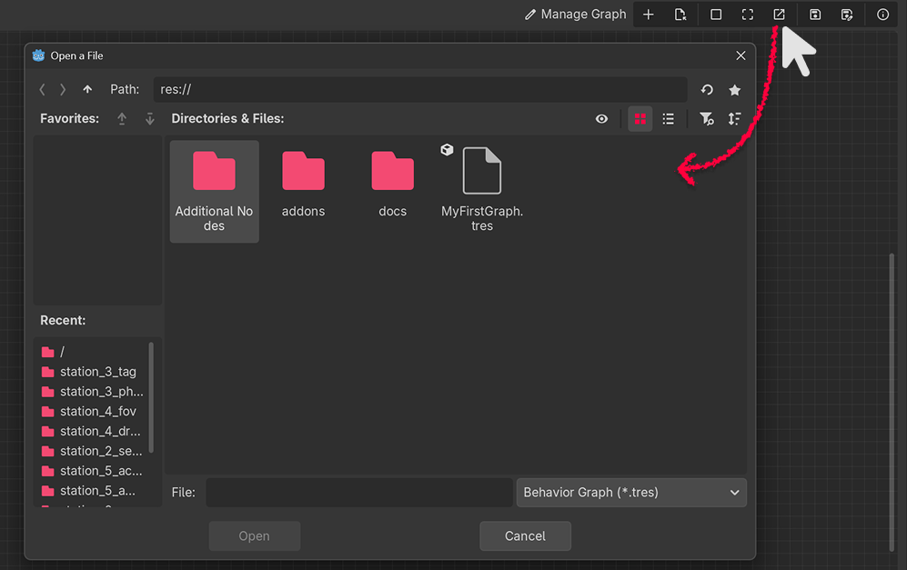

# Embedding Graphs

The **Embed Graph** feature allows you to inline the nodes and connections of an external `BehaviorGraph` resource directly into your current canvas. It acts like a "smart merge", packaging the imported nodes inside a dedicated Frame and preparing them to be wired into your existing graph.

To embed a graph you have to click the **Embed** button in the dock toolbar and select an existing `.tres` BehaviorGraph file from the Godot file dialog.

All imported nodes are automatically attached to a new `BehaviorFrame`. The frame's title is set to the name of the embedded graph file (e.g., `PatrolRoutine`), and its dimensions are sized with padding to neatly encompass all imported nodes.

Since the blackboards of the host graph and the embedded graph are completely separate, any property that was bound to a blackboard variable in the source graph is safely unbound. 

By default, `AccessPointNode`s are omitted from the embed operation. This allows you to immediately connect the host graph's control flow directly into the entry action or composite of the embedded sequence.

---

## Embed Graph vs. Run Subgraph

| Feature | Embed Graph | Run Subgraph Node |
|---|---|---|
| **Mechanism** | Inlines nodes directly into the host canvas. | References an external `.tres` at runtime. |
| **Canvas Impact** | Adds all imported nodes to the graph canvas. | Adds a single compact node to the canvas. |
| **Blackboard** | Unbinds blackboard links; local values only. | Can share blackboard variables with parent graph in real time. |
| **Source Link** | Disconnected; modifications to the original `.tres` do not update the embedded copy. | Linked; updates to the external `.tres` immediately take effect. |
| **Best Used For** | AI templates, boilerplate routines, inlining logic for fine-tuning. | Modular subroutines, reusable combat behaviors, complex multi-graph architectures. |

---

## Next Steps
- Learn how to run graphs modularly without inlining in [The Run Subgraph Node](run_subgraph.md).
- Learn more about frames and grouping in [Canvas Editing & Workflow Features](editing_and_workflow.md).
