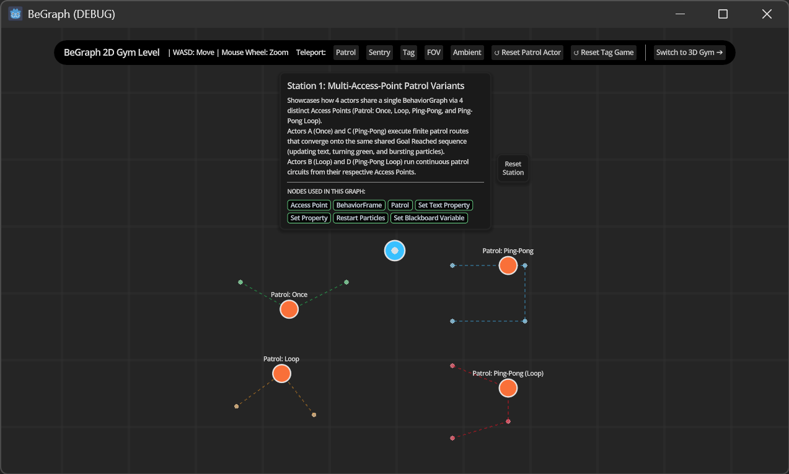
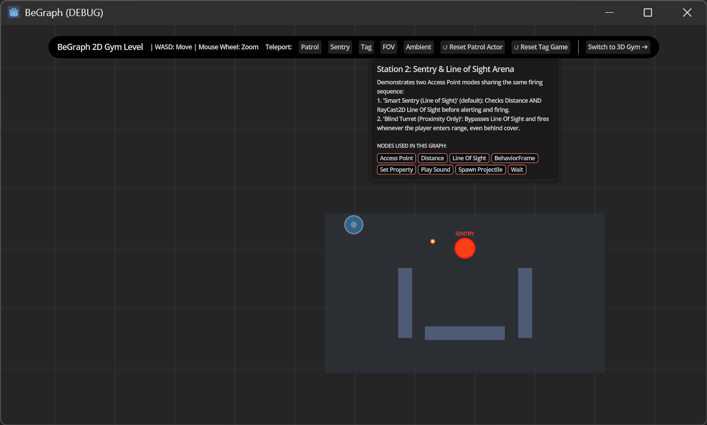
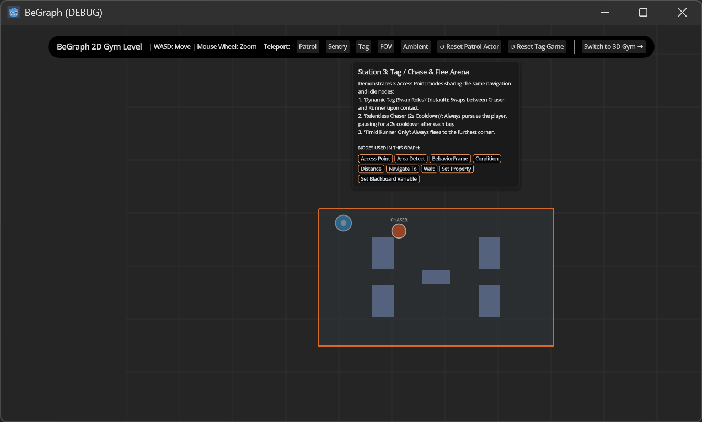
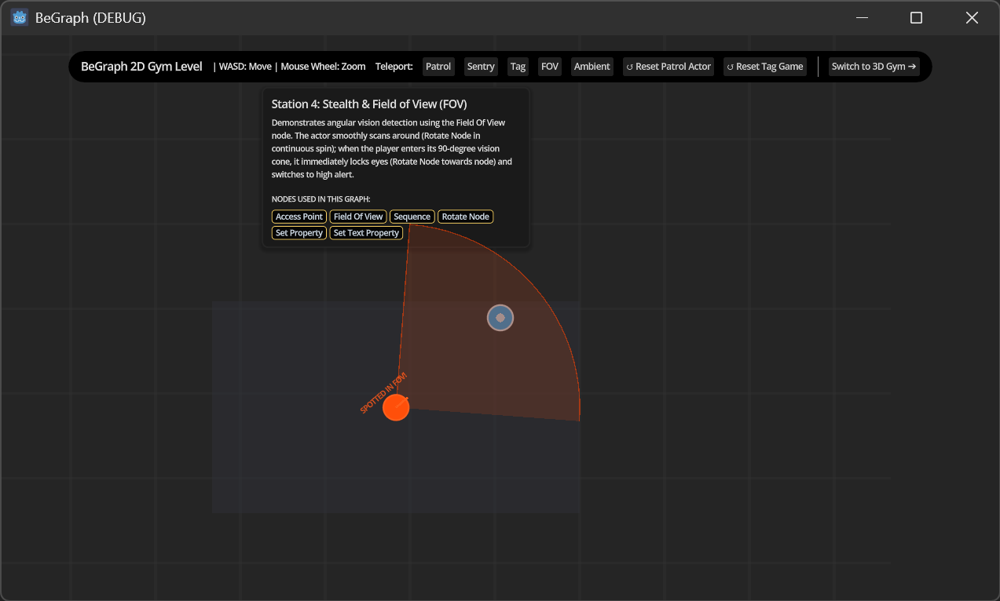
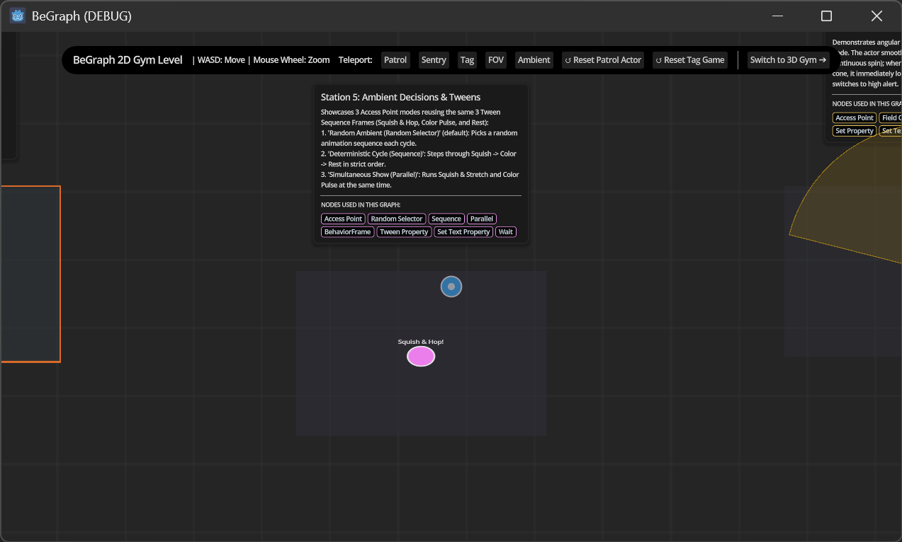

# Gym 2D Showcase & Station Walkthrough

The **Gym 2D** demo scene (`res://addons/BeGraph/DEMO/gym_2d/gym_2d.tscn`) is a hands-on playground designed to demonstrate BeGraph's capabilities in real-time 2D environments. It features a playable character (`Player.tscn`) and 5 dedicated stations, each illustrating different AI paradigms, node combinations, and blackboard patterns.

---

## Shared Architecture

All 2D stations share common design patterns:
1. **`Actor2D`**: A modular `CharacterBody2D` configured with sprites, collision shapes, and a `BehaviorAgent`.
2. **`StationBillboard`**: A floating 2D panel that displays the station title and operational instructions.
3. **Blackboard Dependency Injection**: Scene controllers resolve external node paths (like the Player or arena zones) and inject them as absolute `NodePath`s into each agent's blackboard during `_ready()`.

---

## Station 1: Patrol Circuit

**Path:** `res://addons/BeGraph/DEMO/gym_2d/stations/station_1_patrol/`  
**Graph:** `patrol_graph.tres`  
**Controller:** `station_1_patrol.gd`



### Concepts Demonstrated
- Reusing a single graph resource across multiple agents.
- Access Point branching via `starting_point`.
- Waypoint iteration and path following.

### Nodes Involved
- **`AccessPointNode`** (x4): Four separate entry points inside `patrol_graph.tres`:
  - Index 0: `Patrol: Once`
  - Index 1: `Patrol: Loop`
  - Index 2: `Patrol: Ping-Pong`
  - Index 3: `Patrol: Ping-Pong (Loop)`
- **`Patrol`**: Navigates sequentially between children of a waypoints container node.
- **`Set Blackboard Property`**: Updates the `moving` boolean flag.
- **`Move`**: Moves the character body towards the current active waypoint.
- **`Check Distance`**: Verifies arrival at each waypoint within tolerance.

### Controller Script Injection
In `station_1_patrol.gd`, each actor is given the path to its specific waypoints container and assigned its unique starting point:

```gdscript
actor_a.behavior_agent.set_blackboard_property(&"waypoints", $WaypointsA.get_path())
actor_b.behavior_agent.set_blackboard_property(&"waypoints", $WaypointsB.get_path())
actor_c.behavior_agent.set_blackboard_property(&"waypoints", $WaypointsC.get_path())
actor_d.behavior_agent.set_blackboard_property(&"waypoints", $WaypointsD.get_path())

actor_a.behavior_agent.starting_point = 0
actor_b.behavior_agent.starting_point = 1
actor_c.behavior_agent.starting_point = 2
actor_d.behavior_agent.starting_point = 3
```

---

## Station 2: Sentry Turret

**Path:** `res://addons/BeGraph/DEMO/gym_2d/stations/station_2_sentry/`  
**Graph:** `sentry_graph.tres`  
**Controller:** `station_2_sentry.gd`



### Concepts Demonstrated
- Distance perception and Line-of-Sight verification.
- Spawning projectile instances.
- Audio playback and visual state modulation.

### Nodes Involved
- **`Distance`**: Evaluates the Euclidean distance between `Self` and `Player`.
- **`Line of Sight`**: Casts a 2D raycast towards `Player` to verify unobstructed sight lines.
- **`AudioStreamPlayer Play`**: Plays an alert or firing sound effect.
- **`Spawn Node`**: Instantiates `Projectile.tscn` into the `ProjectilesContainer`.
- **`Wait`**: Enforces a firing cooldown between projectile bursts.
- **`Set Node Property`**: Changes turret tint to red upon detecting the player.

### Controller Script Injection
In `station_2_sentry.gd`, the player reference is injected dynamically:

```gdscript
behavior_agent.set_blackboard_property(&"Player", player.get_path())
```

---

## Station 3: Tag Arena (Chaser vs. Runner)

**Path:** `res://addons/BeGraph/DEMO/gym_2d/stations/station_3_tag/`  
**Graph:** `tag_graph.tres`  
**Controller:** `station_3_tag.gd`



### Concepts Demonstrated
- NavigationServer2D pathfinding via `NavigationAgent2D`.
- Dynamic runtime role switching (Chaser vs. Runner).
- State-driven branch execution.

### Nodes Involved
- **`Selector`**: Root composite choosing between "Flee" and "Chase" branches.
- **`Check Bool State`**: Checks `is_fleeing` on the blackboard.
- **`Navigate To`**: Computes path vectors via `NavigationAgent2D` towards target destinations.
- **`Distance`**: Detects proximity to trigger a role swap upon "tagging".
- **`Set Text`**: Updates `StatusLabel` ("CHASER" vs "FLEEING").
- **`Set Modulate`**: Changes actor color (Red for Chaser, Cyan for Runner).

### Controller Script Injection
```gdscript
behavior_agent.set_blackboard_property(&"player", player.get_path())
behavior_agent.set_blackboard_property(&"CollisionShape", collision_shape.get_path())
behavior_agent.set_blackboard_property(&"EscapeTarget", escape_target.get_path())
behavior_agent.set_blackboard_property(&"ArenaZone", arena_zone.get_path())
behavior_agent.set_blackboard_property(&"TagActor", actor.get_path())
behavior_agent.set_blackboard_property(&"NavigationAgent", navigation_agent_2d.get_path())
behavior_agent.set_blackboard_property(&"StatusLabel", status_lbl.get_path())
```

---

## Station 4: Field of View (FOV Vision Cone)

**Path:** `res://addons/BeGraph/DEMO/gym_2d/stations/station_4_fov/`  
**Graph:** `fov_graph.tres`  
**Controller:** `station_4_fov.gd`



### Concepts Demonstrated
- Angular vision cone perception (`Field Of View`).
- Continuous sweeping rotation.
- Visual status alerts.

### Nodes Involved
- **`Field Of View`**: Evaluates whether `Player` is within a defined vision angle (e.g., $60^\circ$) and distance radius from `Self`.
- **`Rotate Node`**: Continuously rotates the actor back and forth to simulate scanning.
- **`Set Text`**: Switches label between "Patrolling", "Suspicious", and "Detected!".
- **`Set Modulate`**: Updates color from Green (safe) to Red (detected).

---

## Station 5: Ambient Behaviors

**Path:** `res://addons/BeGraph/DEMO/gym_2d/stations/station_5_ambient/`  
**Graph:** `ambient_graph.tres`  
**Controller:** `station_5_ambient.gd`



### Concepts Demonstrated
- Stochastic AI using `Random Selector`.
- Parallel execution using `Parallel`.
- Tween animation sequences without animation players.

### Nodes Involved
- **`Sequence`**: Enforces strict step-by-step execution of sub-actions.
- **`Parallel`**: Runs movement, tweening, and label updates concurrently.
- **`Random Selector`**: Probabilistically picks among idle options (e.g., jump, wander, pause, dance).
- **`Tween Property`**: Animates scale (squash/stretch) or modulate colors.
- **`Wait`**: Adds natural pauses between spontaneous behaviors.

---

## Summary of 2D Gym Takeaways
1. **Shared Graphs**: Multiple agents can execute the same graph resource from different access points.
2. **Perception**: Combine `Distance`, `Line of Sight`, and `Field Of View` for robust stealth and combat logic.
3. **Clean Decoupling**: AI graphs never hardcode scene tree paths; controllers inject absolute paths via `set_blackboard_property()`.

---

## Next Steps
- Explore 3D spatial behaviors in the [Gym 3D Walkthrough](gym_3d.md).
- Learn more about runtime agent configuration in [BehaviorAgent & NodePaths](behavior_agent.md).
