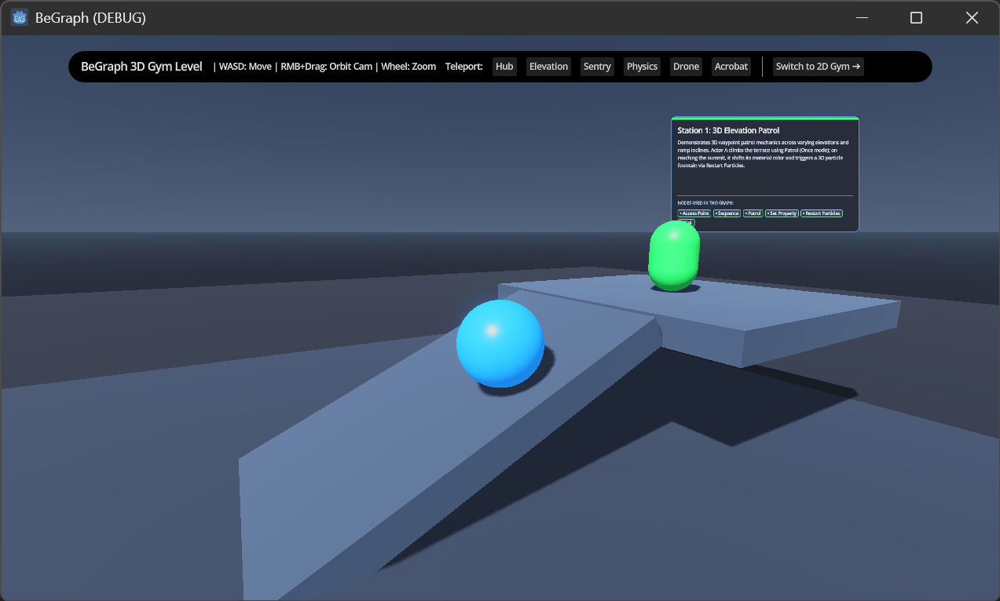
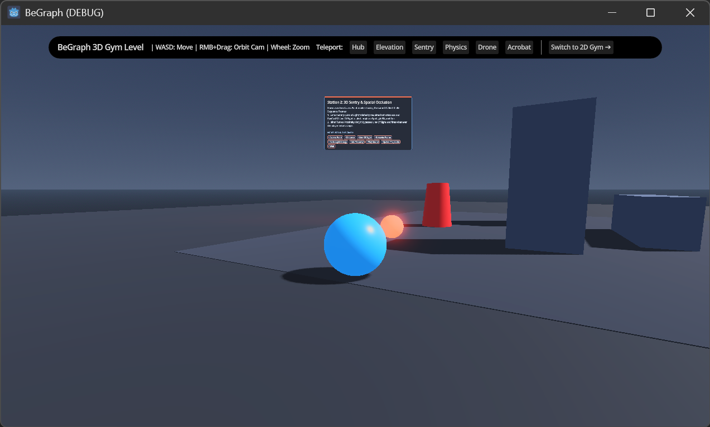
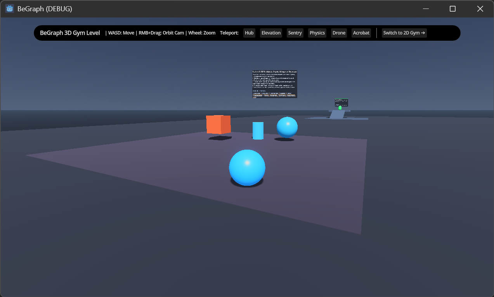
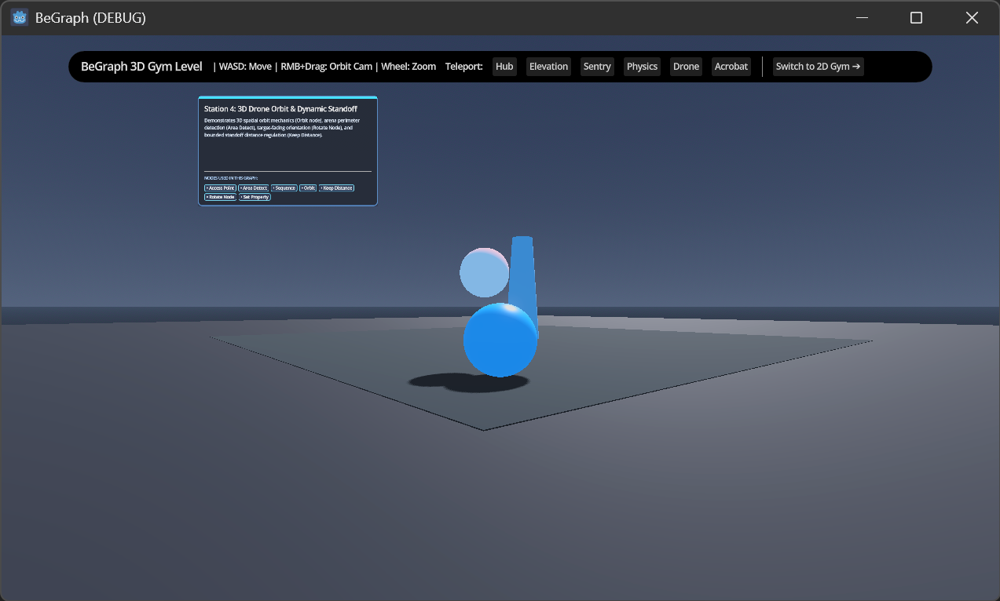
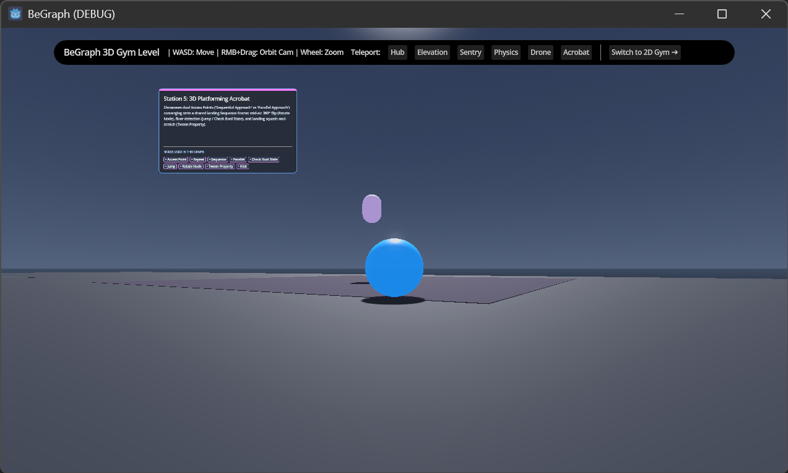

# Gym 3D Showcase & Station Walkthrough

The **Gym 3D** demo scene (`res://addons/BeGraph/DEMO/gym_3d/gym_3d.tscn`) illustrates BeGraph's execution in three-dimensional environments powered by Godot 4 and Jolt Physics. It features a third-person character (`Player3D.tscn`) and 5 specialized 3D stations demonstrating spatial navigation, 3D perception cones, physical impulse interactions, aerial drone hovering, and acrobatic motion.

---

## Shared Architecture in 3D

1. **`Actor3D`**: A `CharacterBody3D` base equipped with a 3D mesh, collision capsule, and a `BehaviorAgent` set to `ProcessThread.PHYSICS`.
2. **`StationBillboard3D`**: A floating 3D billboard presenting station descriptions in world space.
3. **Controller Dependency Injection**: As in 2D, the station controllers dynamically supply absolute `NodePath`s to the `BehaviorAgent` blackboard during `_ready()`.

---

## Station 1: Elevation Patrol

**Path:** `res://addons/BeGraph/DEMO/gym_3d/stations/station_1_elevation_patrol/`  
**Graph:** `patrol_elevation.tres`  
**Controller:** `station_1_elevation_patrol.gd`



### Concepts Demonstrated
- 3D spatial waypoint following across vertical elevation ramps.
- Triggering 3D particle systems (`GPUParticles3D`).
- Modulating material energy and colors on 3D meshes.

### Nodes Involved
- **`Patrol`**: Navigates sequentially between 3D marker nodes.
- **`Set Particles Emitting`**: Toggles a summit particle emitter upon reaching the highest waypoint.
- **`Set Node Property`**: Changes mesh emission energy as the actor climbs.

### Controller Script Injection
```gdscript
behavior_agent.set_blackboard_property(&"Self", climber_actor.get_path())
behavior_agent.set_blackboard_property(&"ParticleEmitter", particles.get_path())
behavior_agent.set_blackboard_property(&"Waypoints", waypoints.get_path())
```

---

## Station 2: 3D Sentry (Omnidirectional Tracking)

**Path:** `res://addons/BeGraph/DEMO/gym_3d/stations/station_2_sentry_3d/`  
**Graph:** `sentry_3d_graph.tres`  
**Controller:** `station_2_sentry_3d.gd`



### Concepts Demonstrated
- 3D spherical proximity detection and RayCast3D line-of-sight.
- Dynamic 3D lighting modulation (`SpotLight3D`).
- Spawning ballistic 3D projectiles (`Projectile3D.tscn`).

### Nodes Involved
- **`Distance`**: Evaluates 3D Euclidean distance between sentry and player.
- **`Line of Sight`**: Verifies unobstructed 3D sight lines via `RayCast3D`.
- **`Set Light Enabled` & `Set Light Color`**: Activates a search spotlight and switches its hue from neutral white to warning red upon detection.
- **`Spawn Node`**: Spawns `Projectile3D.tscn` into the world hierarchy.
- **`AudioStreamPlayer3D Play`**: Plays positional spatial audio.

### Controller Script Injection
```gdscript
behavior_agent.set_blackboard_property(&"Self", sentry_actor.get_path())
behavior_agent.set_blackboard_property(&"RayCast", raycast.get_path())
behavior_agent.set_blackboard_property(&"SpotLight", spot_light.get_path())
behavior_agent.set_blackboard_property(&"AudioPlayer", audio_player.get_path())
behavior_agent.set_blackboard_property(&"ProjectilesParent", projectiles_container.get_path())
behavior_agent.set_blackboard_property(&"Player", player.get_path())
```

---

## Station 3: Physics Impulse (Jolt Physics Integration)

**Path:** `res://addons/BeGraph/DEMO/gym_3d/stations/station_3_physics_impulse/`  
**Graph:** `physics_impulse_graph.tres`  
**Controller:** `station_3_physics_impulse.gd`



### Concepts Demonstrated
- Integrating Behavior Graphs with Godot / Jolt RigidBody physics.
- Trigger zones using `Area3D`.
- Applying 3D directional impulse vectors (`apply_impulse()`).

### Nodes Involved
- **`Area Check`**: Detects when physical crates or players enter the pit's `Area3D`.
- **`Apply Impulse`**: Applies an instantaneous force vector to target `RigidBody3D` instances.
- **`Selector`**: Cycles through available target crates.
- **`Wait`**: Delays strikes to allow realistic physics settling.

### Controller Script Injection
```gdscript
behavior_agent.set_blackboard_property(&"Self", actuator.get_path())
behavior_agent.set_blackboard_property(&"TriggerArea", trigger_area.get_path())
behavior_agent.set_blackboard_property(&"CrateA", crate_a.get_path())
behavior_agent.set_blackboard_property(&"CrateB", crate_b.get_path())
```

---

## Station 4: Drone Orbit (Aerial Navigation)

**Path:** `res://addons/BeGraph/DEMO/gym_3d/stations/station_4_drone_orbit/`  
**Graph:** `drone_orbit_graph.tres`  
**Controller:** `station_4_drone_orbit.gd`



### Concepts Demonstrated
- Continuous aerial hovering and circular orbit mechanics.
- Repulsion / obstacle avoidance (Center Pylon).
- Reactive behavior when player enters the drone's airspace.

### Nodes Involved
- **`Orbit`**: Calculates tangential velocity vectors to orbit a target node at a fixed radius.
- **`Keep Distance`**: Backs away or advances to maintain a safe perimeter.
- **`Rotate Towards`**: Rotates drone yaw to keep visual sensors locked on the target.
- **`Area Check`**: Alerts drone when the player enters the surrounding `ArenaZone`.

### Controller Script Injection
```gdscript
behavior_agent.set_blackboard_property(&"Self", drone_actor.get_path())
behavior_agent.set_blackboard_property(&"CenterPylon", center_pylon.get_path())
behavior_agent.set_blackboard_property(&"ArenaZone", arena_zone.get_path())
behavior_agent.set_blackboard_property(&"Player", player.get_path())
```

---

## Station 5: Acrobat Jump (Complex Composites)

**Path:** `res://addons/BeGraph/DEMO/gym_3d/stations/station_5_acrobat_jump/`  
**Graph:** `acrobat_jump_graph.tres`  
**Controller:** `station_5_acrobat_jump.gd`



### Concepts Demonstrated
- Concurrency using `Parallel` composites.
- Vertical jump physics combined with procedural rotation.
- Looping sequences using `Repeat`.

### Nodes Involved
- **`Parallel`**: Concurrently executes vertical jumping, rotational flipping, and mesh squash/stretch.
- **`Jump`**: Applies upward vertical impulse velocity and monitors floor collision.
- **`Rotate Node`**: Spins the mesh 360 degrees around the local X-axis during the jump apex.
- **`Tween Property`**: Compresses mesh scale on takeoff (squash), stretches in mid-air, and settles on landing.
- **`Repeat`**: Continuously repeats the acrobatic routine with randomized pauses.

---

## Summary of 3D Gym Takeaways
1. **Physics Loop**: In 3D, always configure `BehaviorAgent.graph_process_mode` to **`PHYSICS`** when steering character bodies or querying raycasts.
2. **Parallel Concurrency**: Use `Parallel` nodes to run visual animation tweens simultaneously with gameplay physics.
3. **RigidBody Integration**: BeGraph easily triggers physics forces on `RigidBody3D` nodes via `Apply Impulse`.

---

## Next Steps
- Learn how to inspect running agents in real time in [Advanced Features & Telemetry](advanced_features.md).
- Review [BehaviorAgent & NodePaths](behavior_agent.md) for injection best practices.
