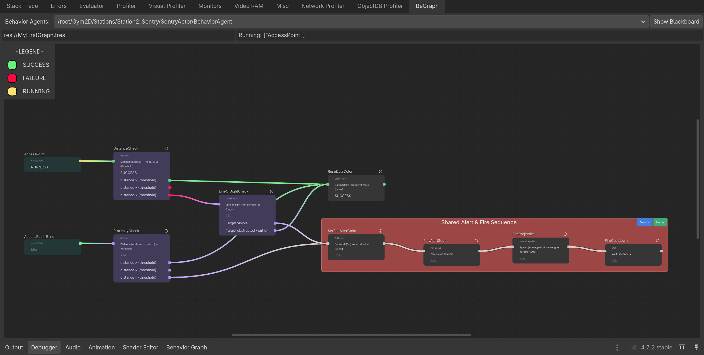
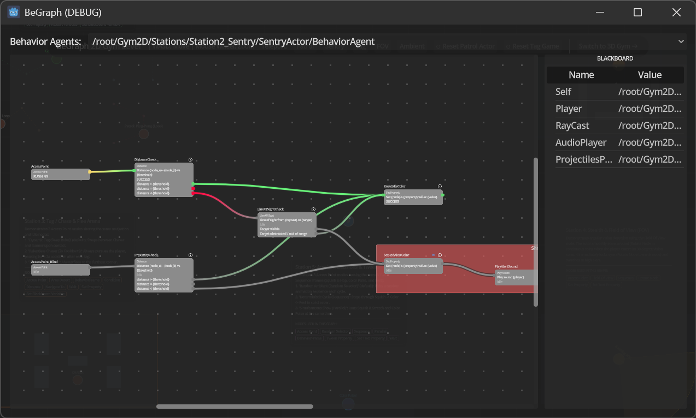

# Advanced Features & Live Debugging

Beyond standard graph authoring, BeGraph includes a live debugging suite, runtime graph inspection and in-game canvas overlays.

---

## The Editor Live Graph Debugger

When your game is running from the Godot editor, BeGraph streams execution state directly into Godot's **Debugger Panel**.

### Architecture
- **`BehaviorGraphDebuggerPlugin`**: Integrates into Godot's bottom panel debugger, receives messages via `EngineDebugger` and visualizes the running graph.
- **`BehaviorGraphDebugBridge`**: An autoload singleton automatically registered by BeGraph (`BeGraphDebugBridge`) that scans all running agents belonging to `BehaviorAgent.DEBUG_GROUP` and transmits:
  1. Initial graph topology (nodes, connections, blackboard structure).
  2. Incremental deltas (only nodes that ticked, properties that updated, and blackboard variables that changed).

In non-debug or exported builds without `--remote-debug`, the bridge automatically disables its timers, incurring zero runtime performance penalty.

---

## The In-Game Runtime Debug Overlay (`F3`)

BeGraph includes an in-game HUD overlay (`BehaviorGraphRuntimeOverlay.tscn`) that allows you to inspect and debug AI agents directly inside the running game window without switching back to the editor.

### Key Capabilities
- **Activation**: Press **`F3`** (configurable via `ProjectSettings -> BeGraph/general_settings/runtime_debug_overlay_toggle_key` or Input Map action `begraph_debug_toggle`). For the debug overlay to be available, **`runtime_debug_overlay_enabled`** inside of **BeGraph -> General Settings** must be set to `true`
- **Agent Picker**: An `OptionButton` dropdown listing all active `BehaviorAgent` instances currently alive in the scene.
- **Interactive Graph Canvas**: Navigate the live graph of the chosen agent to see which branches are actively executing.
- **Live Blackboard Tree**: Real-time tree listing all blackboard keys, their types, and their current values.
- **Pause Resilient**: The overlay runs in `PROCESS_MODE_ALWAYS`, meaning you can pause the game tree to inspect frozen AI state at the exact moment a decision is made.

---

## Next Steps
- Return to the [Documentation Hub](README.md) for a complete list of guides and tutorials.
