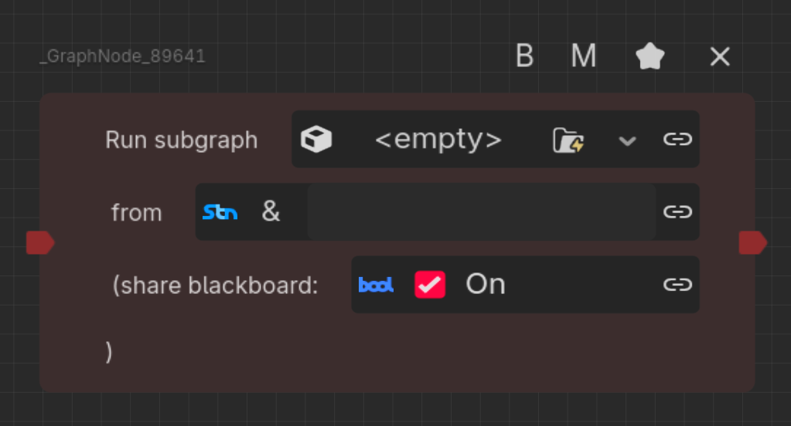

# The Run Subgraph Node

In complex game projects, Behavior Trees can quickly expand into unwieldy graphs with hundreds of nodes. The **`Run Subgraph`** node (`addons/BeGraph/Classes/Nodes/Run Subgraph.gd`) provides modular hierarchical abstraction: it allows an entire external `BehaviorGraph` resource to be executed as a single reusable subroutine inside a parent graph.

---

## Anatomy of the Run Subgraph Node

```
┌────────────────────────────────────────────────────────┐
│  Run Subgraph                                   [B][M] │
├────────────────────────────────────────────────────────┤
│  Run subgraph {subgraph} from {access_point}           │
│  (share blackboard: {share_blackboard})                │
│                                                        │
│  [●] Input                                  Output [●] │
└────────────────────────────────────────────────────────┘
```



| Property | Type | Description |
|---|---|---|
| **`subgraph`** | `BehaviorGraph` | The external `.tres` BehaviorGraph to execute. |
| **`access_point`** | `StringName` | The specific `AccessPointNode` label inside the subgraph from which to start execution. If left empty (`""`), BeGraph defaults to the subgraph's first available access point. |
| **`share_blackboard`** | `bool` | When `true`, synchronizes variables matching the same name between the parent graph and the subgraph. |

One of the most powerful features of `Run Subgraph` is its **name-based Blackboard Sharing**.

When `share_blackboard` is enabled, BeGraph inspects both graphs during `on_start()`:

```gdscript
# Run Subgraph.gd
func _share_blackboard(parent: BehaviorGraph, sub: BehaviorGraph) -> void:
	for i in sub.blackboard.size():
		var sub_variable: BlackboardVariable = sub.blackboard[i]
		if sub_variable == null: continue
		for parent_variable in parent.blackboard:
			if parent_variable != null and parent_variable.name == sub_variable.name:
				# Replaces subgraph's variable reference with the parent's instance!
				sub.blackboard[i] = parent_variable
				break
```

```
Parent Graph Blackboard               Subgraph Blackboard
┌──────────────────────┐             ┌──────────────────────┐
│ Name: "TargetPos"    │◄───────────►│ Name: "TargetPos"    │ (SHARED INSTANCE)
│ Value: (120, 450)    │             │ Value: (120, 450)    │
├──────────────────────┤             ├──────────────────────┤
│ Name: "PlayerHealth" │             │ Name: "LocalTimer"   │ (LOCAL TO SUBGRAPH)
│ Value: 100           │             │ Value: 5.0           │
└──────────────────────┘             └──────────────────────┘
```

### Key Behaviors:
1. **Shared Variables**: Any variable in the subgraph that shares a name with a variable in the parent graph points to the **exact same `BlackboardVariable` instance**. If an action inside the subgraph updates `TargetPos`, the parent graph and all other nodes linked to `TargetPos` immediately see the change!
2. **Local Variables**: Variables declared in the subgraph that do not exist in the parent remain local to the subgraph. They maintain their own independent lifecycle.
3. **Blackboard Map Rebuild**: After variable substitution, `runtime._rebuild_blackboard_map()` re-indexes lookups so runtime `eval()` calls execute in $O(1)$ time.

---

## Execution Lifecycle & Runtime Caching

### 1. `on_start()`
BeGraph instantiates the child graph using deep duplication:
```gdscript
runtime = source.duplicate_deep(Resource.DEEP_DUPLICATE_ALL)
runtime.setup_runtime(agent, source)
```
- Duplication ensures the subgraph operates with its own active branch state, timers, and node execution status without mutating the original disk resource.
- **Instance Caching**: BeGraph caches the runtime graph (`_cached_runtime`) keyed by `[source_resource, access_point]`. On subsequent execution cycles, BeGraph resets node states (`last_status = -1`) and reuses the cached instance, eliminating unnecessary memory allocations.

### 2. `tick(delta: float) -> Status`
- Execution enters the designated `AccessPointNode` and flows to its successor via `tick_next(delta)`.
- While the subgraph's active branch is progressing, `Run Subgraph` returns **`Status.RUNNING`**.
- When the subgraph's branch finishes, `Run Subgraph` returns the child's final status (**`Status.SUCCESS`** or **`Status.FAILURE`**).

### 3. Preemption & Abortion Bubbling
If a parent composite (such as a reactive Selector or Parallel node) cancels the branch containing `Run Subgraph`:
- `_on_abort_running(visited)` is called.
- The abortion cascades directly into the active subgraph entry via `_entry.abort_running(visited)`.
- All `RUNNING` nodes within the subgraph receive `on_end(Status.FAILURE)` and clean up their state properly.

---

## Recursion Guard: `MAX_DEPTH`

To prevent accidental infinite recursion (e.g., Graph A running Graph B, which runs Graph A):

```gdscript
const MAX_DEPTH: int = 16
const DEPTH_META: StringName = &"begraph_subgraph_depth"

var depth: int = int(parent.get_meta(DEPTH_META, 0)) + 1
if depth > MAX_DEPTH:
	push_error("Maximum subgraph recursion depth (%d) exceeded" % MAX_DEPTH)
	return false
```

BeGraph tracks recursion depth across nested graphs and aborts execution if nesting exceeds 16 layers.

---

## Next Steps
- Compare with inlining graphs in [Embedding Graphs](embed_graphs.md).
- See practical usage of subgraphs in the [Gym 2D Walkthrough](gym_2d.md) and [Gym 3D Walkthrough](gym_3d.md).
