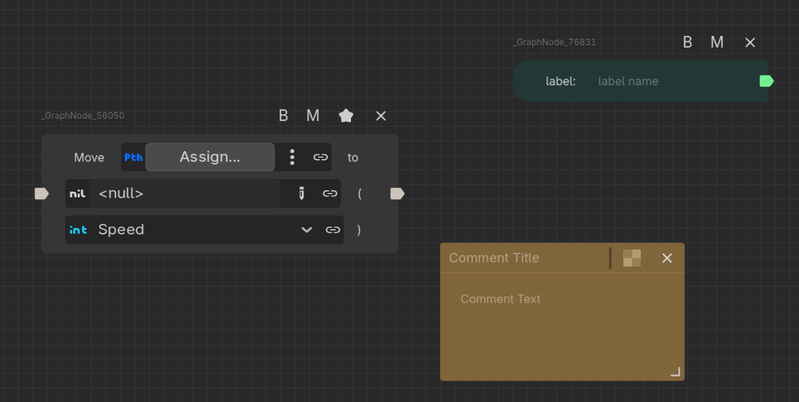

# Writing Special Custom Nodes

In **BeGraph**, standard behavior nodes use a generic scene (`BehaviorGraphNode.tscn`) to parse `{property}` tokens into inline editors. However, certain nodes require dedicated user interfaces, specialized canvas behaviors, or non-executable functions. These are called **Special Nodes**.

Prominent examples of special nodes include:
- **`AccessPointNode`**: The entry point to a graph, rendering an inline label editor and exposing itself to `BehaviorAgent`.
- **`CommentNode`** (`BehaviorComment`): A visual canvas annotation node with resizable multiline text, no ports, and no runtime execution.

This guide explains how special nodes work and how to create your own custom visual nodes using `DISPLAY_SCENE`.

---

## How Special Nodes Work

When BeGraph instantiates a node on the canvas, it checks the node script's constants map:

```gdscript
# BehaviorGraphEdit.gd
func _scene_for(n: BehaviorNode) -> PackedScene:
	var consts: Dictionary = n.get_script().get_script_constant_map()
	if not consts.has("DISPLAY_SCENE"):
		return NODE # Default BehaviorGraphNode.tscn
	return load(consts["DISPLAY_SCENE"])
```

If `DISPLAY_SCENE` is present, BeGraph loads that `.tscn` instead of the generic node scene.



---

## Anatomy of the Visual Base: `BehaviorGraphNodeBase`

Any custom scene intended for BeGraph must have a root node that extends `BehaviorGraphNodeBase` (which in turn inherits Godot's native `GraphNode`).

`BehaviorGraphNodeBase` automatically handles:
- The node's title synchronization and resource naming.
- Graph slot configuration (`set_slot_enabled_left` for inputs, `set_slot_enabled_right` for outputs).
- Titlebar buttons: Close/Delete button (`close_icon.svg`), Breakpoint toggle (`B`), Mute toggle (`M`), and Free from Frame button.
- Frame Sequence badges (`#1`, `#2`, etc.).
- Theming and color synchronization via `set_node_color()`.

### The `_on_node_set()` Lifecycle Hook
When the scene is instantiated, BeGraph assigns the underlying `BehaviorNode` resource by calling `set_node(n)`. Once base setup is complete, it invokes `_on_node_set()`. You override this virtual method to bind your custom controls to the resource.

```gdscript
# MySpecialGraphNodeUI.gd (attached to root of MySpecialGraphNodeUI.tscn)
@tool
extends BehaviorGraphNodeBase

@onready var custom_slider: HSlider = %CustomSlider
@onready var value_label: Label = %ValueLabel

func _on_node_set() -> void:
	var my_res := node as MySpecialNode
	if my_res == null:
		return
	
	custom_slider.value = my_res.slider_value
	value_label.text = str(my_res.slider_value)
	
	custom_slider.value_changed.connect(func(val: float):
		my_res.slider_value = val
		value_label.text = str(val)
	)
```

---

## Case Study 1: `AccessPointNode`

`AccessPointNode` is the starting point for execution. Multiple access points can exist in a single graph, allowing different `BehaviorAgent`s to trigger different routines.

### The Resource Script (`AccessPointNode.gd`)
```gdscript
@tool
class_name AccessPointNode
extends BehaviorNode

const DISPLAY_NAME: String = "Access Point"
const DISPLAY_ICON: String = "res://addons/BeGraph/Icons/access_point_node_icon.svg"
const DISPLAY_SCENE: String = "res://addons/BeGraph/UI/BehaviorGraphAccessPoint.tscn"
const DISPLAY_INFO: String = "Entry point of the graph. Ticks its successor every frame."

## The entry point name chosen in BehaviorAgent's starting_point dropdown
@export_storage var label: String = ""

func tick(delta: float) -> Status:
	if _next_ref.size() > 0:
		tick_next(delta)
	return Status.RUNNING

func set_instruction() -> String: return ""
func set_node_category() -> String: return "access_point_node"
func set_input() -> bool: return false             # Entry points have no predecessors
func set_output() -> bool: return true            # Exactly one outgoing connection
func set_allows_multiple_outputs() -> bool: return false
```

### The Visual Scene (`BehaviorGraphAccessPoint.gd`)
The scene contains a `LineEdit` that updates the `label` property directly on the resource:
```gdscript
@tool
extends BehaviorGraphNodeBase

@onready var label_edit: LineEdit = %LabelEdit

func _on_node_set() -> void:
	var ap := node as AccessPointNode
	label_edit.text = ap.label
	label_edit.text_changed.connect(func(new_text: String):
		ap.label = new_text
		# Notify graph so any inspecting BehaviorAgent updates its enum
		if ap.get_graph():
			ap.get_graph().notify_property_list_changed()
	)
```

---

## Case Study 2: `CommentNode`

A comment node serves strictly as visual documentation. It does not execute and does not connect to other nodes.

### The Resource Script (`CommentNode.gd`)
```gdscript
@tool
class_name BehaviorComment
extends BehaviorNode

const DISPLAY_NAME: String = "Comment"
const DISPLAY_ICON: String = "res://addons/BeGraph/Icons/comment_node_icon.svg"
const DISPLAY_SCENE: String = "res://addons/BeGraph/UI/BehaviorGraphComment.tscn"
const DISPLAY_INFO: String = "Visual-only annotation node. Shows a title and multiline comment."

@export var comment_title: String = ""
@export var comment_text: String = ""
@export var node_size: Vector2 = Vector2.ZERO

func tick(_delta: float) -> Status:
	return Status.FAILURE

func set_instruction() -> String: return "{comment}"
func set_node_category() -> String: return "comment_node"
func set_input() -> bool: return false             # No input port
func set_output() -> bool: return false            # No output port
func set_breakpointable() -> bool: return false    # Cannot set breakpoints on notes
func set_mutable() -> bool: return false           # Cannot mute a comment
func set_allows_multiple_outputs() -> bool: return false
```

### Key Differences in UI
In `BehaviorGraphComment.tscn`:
- It enables resize handles (`resizable = true`).
- It has a `TextEdit` for free-form multi-line markdown or developer notes.
- Title and text changes are synced into `comment_title` and `comment_text`.

---

## Tutorial: Building a Custom "Progress Gauge" Special Node

Let's build a special node that visually displays a live mini gauge or progress bar directly on the graph node body, configurable via an interactive slider.

### Step 1: Create the Resource Class (`GaugeNode.gd`)
Create `GaugeNode.gd`:

```gdscript
@tool
class_name GaugeNode
extends BehaviorNode

const DISPLAY_NAME: String = "Gauge Node"
const DISPLAY_ICON: String = "res://addons/BeGraph/Icons/control_flow_node_icon.svg"
const DISPLAY_SCENE: String = "res://custom_nodes/GaugeNodeUI.tscn"
const DISPLAY_INFO: String = "Custom visual node featuring an interactive gauge meter."

@export var gauge_title: String = "Sensor"
@export var target_level: float = 75.0

func set_node_category() -> String:
	return "action_node"

func set_input() -> bool: return true
func set_output() -> bool: return true
func set_allows_multiple_outputs() -> bool: return false
func set_instruction() -> String: return ""

func tick(delta: float) -> Status:
	# Runtime logic here
	print("Executing GaugeNode: %s at %f%%" % [gauge_title, target_level])
	return Status.SUCCESS
```

### Step 2: Build the UI Scene (`GaugeNodeUI.tscn`)
1. Create a new scene with root node type `GraphNode`.
2. Attach a script `GaugeNodeUI.gd` extending `BehaviorGraphNodeBase`.
3. Add a `VBoxContainer` child containing:
   - A `LineEdit` for editing `gauge_title`.
   - A `ProgressBar` showing `target_level`.
   - A `HSlider` to adjust the percentage from 0 to 100.
4. Set minimum sizes, custom styles, and save the scene to `res://custom_nodes/GaugeNodeUI.tscn`.

```gdscript
# GaugeNodeUI.gd
@tool
extends BehaviorGraphNodeBase

@onready var title_edit: LineEdit = $VBoxContainer/TitleEdit
@onready var progress_bar: ProgressBar = $VBoxContainer/ProgressBar
@onready var slider: HSlider = $VBoxContainer/HSlider

func _on_node_set() -> void:
	var g := node as GaugeNode
	if g == null:
		return
	
	title_edit.text = g.gauge_title
	progress_bar.value = g.target_level
	slider.value = g.target_level
	
	title_edit.text_changed.connect(func(new_text: String):
		g.gauge_title = new_text
	)
	
	slider.value_changed.connect(func(new_val: float):
		g.target_level = new_val
		progress_bar.value = new_val
	)
```

---

## Best Practices for Special Nodes
1. **Always inherit `BehaviorGraphNodeBase`**: Do not extend raw `GraphNode`, otherwise you lose title bar management, slot coloring, mute/breakpoint buttons, and frame support.
2. **Use `@tool` on both scripts**: Both the resource and UI script must execute in the editor to render within the BeGraph dock.
3. **Guard with null checks**: In `_on_node_set()`, always verify that `node` is non-null and matches your expected class type using `as MyNodeType`.
4. **Use undo/redo where appropriate**: For critical user edits, connect into `graph_edit.undo_redo` so canvas modifications can be reversed.

---

## Next Steps
- Learn how to register custom colors for your special nodes in [Categories and Node Scanning](categories_and_scanning.md).
- Explore grouping multiple nodes with [Frames and Workflow Features](editing_and_workflow.md).
